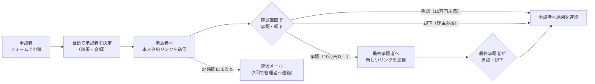
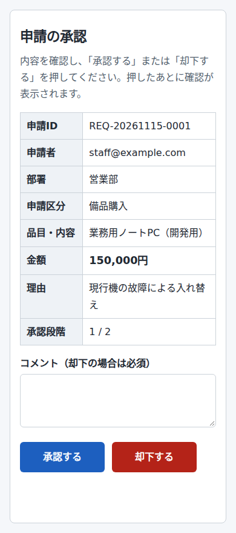
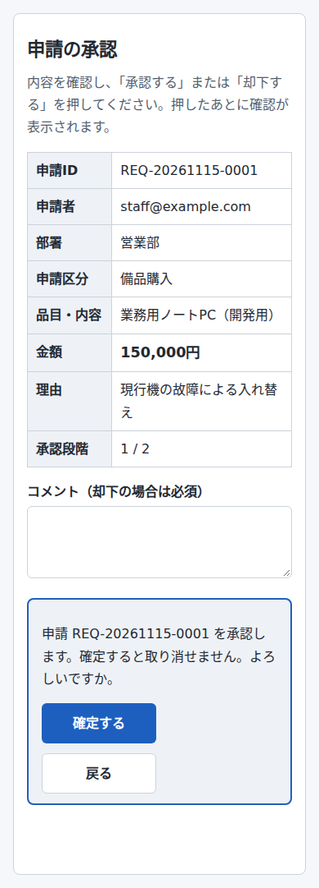

# 経費・備品購入申請の承認フロー（Google Apps Script）

本リポジトリはポートフォリオ（閲覧用）です。無断での再利用・再配布はご遠慮ください。

経費の立替精算や備品購入の申請を、Google フォームから送るだけで、社内規程に沿った承認者へ自動で回し、承認・却下の結果を申請者へ知らせる仕組みです。紙の申請書やメールでの承認で起きていた「誰の所で止まっているか分からない」「承認者を間違えて差し戻し」「同じ申請を二度処理」をなくすことを目的としています。

| 項目 | これまで | 導入後 |
|------|----------|--------|
| 申請の方法 | 紙の申請書に記入し、上長の机へ回す | Google フォームに入力して送信するだけ |
| 承認者の決め方 | 申請者が社内規程を見て判断（間違えると差し戻し） | 部署と金額から自動で決定。10万円以上は最終承認者を加えた2段階 |
| 承認の操作 | 押印、またはメールで「承認します」と返信 | メールのリンクから確認画面を開き、ボタンで承認・却下 |
| 止まっている申請 | 申請者が催促するまで気付かない | 24時間ごとに承認者へ自動で督促。3回で管理者に連絡 |
| なりすまし・二重処理 | 返信メールだけでは本人か確かめられない | 本人専用・1回限り・期限付きのリンクで、本人以外と2回目の操作を拒否 |
| 記録 | 紙とメールに分散 | 誰が・いつ・何をしたかを1つのシートに自動で記録 |

> 本文中の会社・部署・メールアドレス（example.com）はすべて架空です。

## 用語

| 用語 | 意味 |
|------|------|
| Google Apps Script（GAS） | Google のスプレッドシートやメールを、プログラムで自動処理できる Google の仕組み |
| ウェブアプリ | GAS で作った画面を、URL で開けるようにしたもの。本システムでは承認の確認画面 |
| トリガー | 「フォームが送信されたら」「1時間ごとに」など、決まったきっかけでプログラムを動かす設定 |
| トークン | 承認リンクに含める、改ざんを見破るための署名付きの文字列 |
| 監査ログ | 操作の記録。後から書き換えない前提で、追記だけを行うシート |

## 概要

- 申請：Google フォーム → スプレッドシートの回答シートに追記
- 承認者の決定：`承認ルール` シート（部署・金額の範囲ごとの承認者）と `設定` シート（2段階にする金額・最終承認者）に従って自動で決定
- 承認：承認者にメールでリンクを送り、確認画面で「承認する／却下する」→「確定する」
- 通知：結果を申請者へメールで連絡。2段階の場合は次の承認者へ自動で回す
- 督促：1時間ごとの見回りで、24時間以上止まっている申請の承認者へ督促
- 記録：受付・承認・却下・督促・拒否した操作を `監査ログ` シートへ記録

## できること

| できること | 確認したテスト |
|------------|----------------|
| フォームの入力を検査し、不正な申請（小数の金額・選択肢にない部署など）は登録せず管理者に連絡 | TC-011〜TC-013, TC-034 |
| 部署・金額から承認者を決定。10万円以上は2段階承認 | TC-001〜TC-010, TC-041 |
| 申請者本人が承認者になる場合は代理承認者へ回す（自己承認の防止） | TC-006〜TC-008 |
| リンクを開いただけでは承認されず、確認画面で2回の操作をして確定 | TC-036, TC-050, TC-051 |
| 同じリンクでの2回目の操作、却下後の承認、承認者以外の操作を拒否 | TC-038〜TC-040 |
| 未処理の申請への督促と、上限超過時の管理者への連絡 | TC-053〜TC-057 |
| すべての操作を監査ログに記録（リンクの文字列や鍵は記録しない） | TC-032, TC-037, TC-047 |
| 説明用の架空データ（シート別の CSV）の作成 | TC-064〜TC-068 |

### 要件 → 機能 → テストのつながり（抜粋）

| 要件 | 機能 | テスト |
|------|------|--------|
| REQ-003 しきい値以上は2段階承認 | FN-002 承認経路の決定 | TC-002, TC-003, TC-041 |
| REQ-101 なりすまし防止 | FN-003 トークン ／ FN-006 確定 | TC-017〜TC-019, TC-024, TC-040 |
| REQ-102 二重承認防止 | FN-004 状態遷移 ／ FN-006 確定 | TC-029, TC-038, TC-039 |
| REQ-103 有効期限 | FN-003 トークン | TC-020, TC-042 |
| REQ-105 権限の最小化 | FN-012 呼び出し元の検証 | TC-035, TC-058, TC-061 |
| REQ-006 督促 | FN-008 選定 ／ FN-009 実行 | TC-053〜TC-059 |

全件の対応は [要件定義](docs/01_要件定義.md)・[基本設計](docs/02_基本設計.md)・[テスト仕様書](docs/05_テスト仕様書.md) にあります。

## 業務の流れ（図）



### 承認の確認画面

承認者がメールのリンクを開くと表示される画面です（スマートフォン幅 390px）。「承認する」を押すと確認が表示され、「確定する」を押したときに初めて確定します。

| 開いたとき | 「承認する」を押したとき |
|------------|--------------------------|
|  |  |

> 画像は、手元の Node.js で偽の Google 環境からテンプレートを展開し、ブラウザ（Chromium）で描画したものです。実際の Google 環境の画面ではありません。

## 構成

```text
src/                         GAS のソース（TypeScript と画面のテンプレート）
  Routing.ts                 入力の検査・承認経路の決定（Google のサービスを使わない）
  Token.ts                   トークン・確認用の値の署名と検証（同上）
  StateMachine.ts            申請の状態遷移（同上）
  Reminder.ts                督促対象の選定（同上）
  Repository.ts              シートの読み書き・数式の無効化
  Notifier.ts                メールの文面と送信
  Guard.ts                   トリガー・管理者の検証
  View.ts                    画面の組み立て
  Main.ts                    入口（公開関数5つ）
  Approval.html, Message.html 承認の確認画面・案内画面（HTML・CSS・画面側の JavaScript）
  appsscript.json            タイムゾーン・権限（スコープ）・ウェブアプリの設定
tools/                       サンプルデータ作成のコマンド（Node.js・TypeScript）
test/                        自動テスト（Node.js・TypeScript、68件）
sample-data/                 架空のサンプル CSV
docs/                        設計書一式・ADR
```

| 言語 | 使う場所 | 理由 |
|------|----------|------|
| TypeScript | GAS のソース | 申請・トークン・設定の項目を型で決め、取り違えをビルド時に見つけるため。出力は GAS の作法どおりの JavaScript |
| HTML・CSS・JavaScript | 承認の確認画面 | 承認者が操作する唯一の画面を、見た目と操作（2段階の確定・二重押し防止）に分けて作るため |
| TypeScript（Node.js） | テスト・サンプルデータ作成 | GAS と同じ言語・同じ型で、Google 環境なしに検証するため |

詳細は [基本設計 1.2](docs/02_基本設計.md) と [ADR 0003](docs/adr/0003-typescript-and-local-verification.md) を参照してください。

## 導入方法

概要のみ記載します。詳しい手順は [導入・運用手順書](docs/06_導入・運用手順.md) を参照してください。

1. `npm ci` → `npm test`（ビルドと自動テスト）
2. スプレッドシートを作り、`npm run sample-data` で作った CSV を各シートに取り込み、承認者を実際のアドレスに直す
3. Google フォームを作り、回答先をそのスプレッドシートにする
4. `.clasp.json.example` を `.clasp.json` に複製してスクリプト ID を入れ、`npm run build` → `clasp push`
5. エディタで `setupProject` を実行（鍵の生成・トリガーの登録・権限の許可）
6. ウェブアプリとして公開（実行は自分・アクセスは組織内）し、URL をスクリプトのプロパティ `WEBAPP_URL` に保存
7. 管理用のシートを保護し、テスト用アカウントで動作を確認

## セキュリティの工夫

| 工夫 | 内容 |
|------|------|
| 外から呼べる関数を5つに限定 | GAS では名前が `_` で終わらない関数は画面から呼べてしまうため、公開しない関数はすべて末尾に `_` を付けた。公開関数の一覧はテスト（TC-061）で固定 |
| 署名付き・期限付き・1回限りのリンク | リンクのトークンに HMAC-SHA256 の署名と期限を付け、使用済みかどうかをサーバー側で管理。署名用の鍵はスクリプトのプロパティに置き、コードには書かない |
| 承認者本人の確認 | 画面を開いた人のメールアドレスが、割り当てた承認者と一致する場合だけ操作できる。確認できない場合は拒否 |
| 開いただけでは承認しない | メールのセキュリティ製品によるリンクの先読みで承認されないよう、確認画面で2回の操作をして初めて確定 |
| CSRF 対策 | 確定の操作には、本人が確認画面を開いたときに作る署名付きの値（15分有効）を必須にした |
| 二重承認の防止 | 排他制御の中で状態を読み直し、承認済み・却下の申請への操作は拒否 |
| トリガーの検証 | トリガー用の関数は、イベント情報の識別子が登録済みのトリガーと一致する場合だけ動く |
| 権限の最小化 | 紐づいたスプレッドシートだけ・メール送信だけなど、必要な4つのスコープだけを明示 |
| 入力の無害化 | 画面に出す値はエスケープし、シートに書く値は数式として動かないようにした |

詳細は [権限設計](docs/04_権限設計.md)・[詳細設計](docs/03_詳細設計.md)・[ADR 0002](docs/adr/0002-signed-single-use-token.md) を参照してください。

## 確認していないこと

- **実際の Google 環境での動作は確認していません（未実施）。** 本リポジトリの作成では Google アカウントに接続せず、`clasp push`・ウェブアプリの公開・トリガー・メール送信・権限の同意画面は実行していません。
- 確認したのは、手元の Node.js で GAS のサービスを偽物に差し替えて動かす自動テスト68件です（[テスト仕様書](docs/05_テスト仕様書.md)）。偽物は本システムが使う部分だけを再現したものです。
- 「自分として実行」するウェブアプリで承認者のメールアドレスを取得できるかは、公式の説明では同じ Google Workspace ドメインかどうかに依存します。本システムは取得できない場合は操作を拒否しますが、導入先で取得できることは未確認です。
- メール送信数・実行時間などの上限は導入先の契約によるため、記載していません。

## 動作環境

| 項目 | 内容 |
|------|------|
| 実行先 | Google Apps Script（V8 ランタイム）・Google Workspace（未確認） |
| 開発・テスト | Node.js 22.18 以上（TypeScript の型の除去機能を使用。確認は v22.22.2）、TypeScript 5.9.3 |
| テスト | Node.js 標準のテスト機能（`node:test`）。外部のテストライブラリは使用しない |
| 配置 | clasp（`dist/` を送る） |

## 設計書

| 文書 | 内容 |
|------|------|
| [01_要件定義](docs/01_要件定義.md) | 背景・課題・要件（REQ） |
| [02_基本設計](docs/02_基本設計.md) | 構成図・使用言語・機能一覧（FN）・業務フロー・シート定義 |
| [03_詳細設計](docs/03_詳細設計.md) | 状態遷移・トークン方式・例外表・ログ方針 |
| [04_権限設計](docs/04_権限設計.md) | 役割と権限・スコープの理由・公開関数一覧 |
| [05_テスト仕様書](docs/05_テスト仕様書.md) | テストケース（TC）と実施結果・未実施の項目 |
| [06_導入・運用手順](docs/06_導入・運用手順.md) | 導入手順・導入時の確認・運用 |
| [ADR](docs/adr/) | 0001 構成の選択／0002 承認リンクの方式／0003 TypeScript と手元での検証 |
| [CHANGELOG](CHANGELOG.md) | 変更履歴 |
