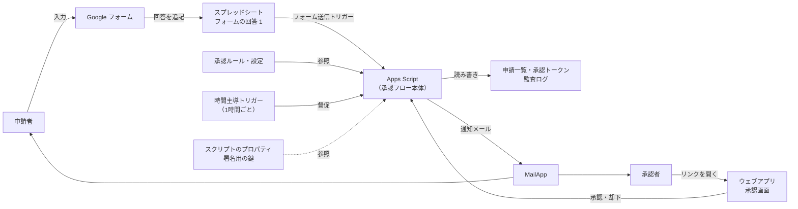
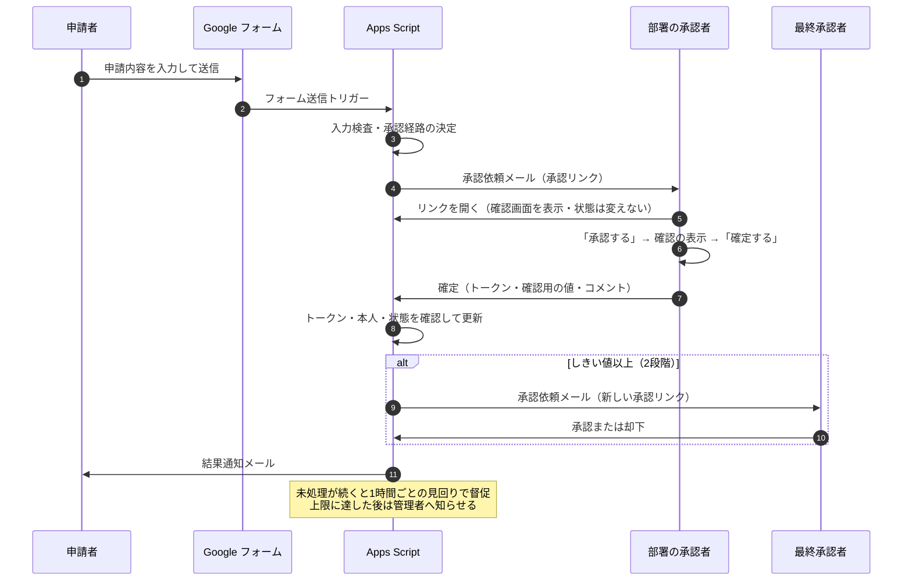

# 基本設計書

## 文書情報

| 項目 | 内容 |
|------|------|
| 文書名 | 基本設計書（経費・備品購入申請の承認フロー） |
| 版 | 1.4 |
| 作成日 | 2026-11-15 |

## 改版履歴

| 版 | 日付 | 内容 |
|----|------|------|
| 1.0 | 2026-11-15 | 初版作成 |
| 1.1 | 2026-11-15 | 使用言語と役割（1.2）を追加。コードの分け方を TypeScript・HTML の構成に更新。FN-013 を追加。業務フローに確認画面の2段階操作を反映 |
| 1.2 | 2026-11-15 | 設定に「申請者ドメイン」を追加。フォームの回答シートのメールアドレスは「確認済み」で収集する前提を明記 |
| 1.3 | 2026-11-16 | 文章を見直し（表記ゆれを修正）。1.1 のコードの分け方に共通（`Config.ts` `Types.ts`）を追加。4.4 の督促上限回数の意味を実装に合わせて「達したら」に修正 |
| 1.4 | 2026-11-16 | 表記の残りをそろえた（督促の「上限超過」を「上限に達した後」に、「偽物」を「代替部品」に） |

## 1. システム構成

Google スプレッドシートに紐づいた Apps Script（以下 GAS）1本で構成する。外部サーバーは使わない。

### 1.1 コードの分け方

| 層 | ファイル（`src/`） | 内容 | Google のサービス |
|----|----------|------|-------------------|
| 純粋ロジック | `Routing.ts` `Token.ts` `StateMachine.ts` `Reminder.ts` | 承認経路の決定、トークン・確認用の値の署名と検証、状態遷移、督促対象の選定 | 使わない（引数で受け取る） |
| 入出力 | `Repository.ts` `Notifier.ts` `Guard.ts` `View.ts` | シートの読み書き、メール送信、呼び出し元の検証、画面の組み立て | 使う |
| 入口 | `Main.ts` | トリガー・ウェブアプリの入口（公開関数） | 使う |
| 共通 | `Config.ts` `Types.ts` | シート名などの定数・設定シートの値の解釈・共通の小さな関数、全ファイルで共有する型 | 使わない |
| 画面 | `Approval.html` `Message.html` | 承認の確認画面・案内画面（HTML・CSS・画面側のスクリプト） | google.script.run |
| 補助（GAS の外） | `tools/generate-sample-data.ts` | 架空のサンプルデータ（シート別 CSV）の作成 | 使わない |

純粋ロジックは Google のサービスを直接呼ばないため、手元の Node.js で自動テストできる（REQ-108）。

### 1.2 使用言語と役割

| 言語 | 使う場所 | 理由 |
|------|----------|------|
| TypeScript（GAS 用） | `src/*.ts` → `dist/*.js` | 申請・トークン・設定の形を型で決め、列の取り違えや項目名の誤りをビルド時に見つけるため。出力は import を使わない通常のスクリプトにし、GAS のグローバル空間の作法（末尾 `_` で非公開）をそのまま守る |
| HTML・CSS・JavaScript（画面） | `src/Approval.html` `src/Message.html` | 承認画面は承認者が操作する唯一の画面のため、見た目と操作（2段階の確定・送信中の二重押し防止・結果表示）をサーバー側のコードから分けて読みやすくするため。値は GAS のテンプレートの印字スクリプトレット（`<?= ?>`）でエスケープして埋め込む |
| TypeScript（Node.js） | `test/*.ts` `tools/*.ts` | テストとサンプルデータ作成を GAS と同じ言語で書き、型をそろえるため。Node.js の型の除去機能でそのまま実行し、別のビルドを挟まない |
| Mermaid | `docs/*.md` | 構成・業務の流れ・状態遷移を、文章と同じファイルで差分管理できる図にするため |

詳しい判断の経緯は [ADR 0003](adr/0003-typescript-and-local-verification.md) に記す。

## 2. 機能一覧

| ID | 機能名 | 概要 | 関連要件 |
|----|--------|------|----------|
| FN-001 | 申請受付 | フォーム送信を受け、入力を検査して申請一覧に登録し、1段目の承認者にメールを送る | REQ-001, REQ-004, REQ-007 |
| FN-002 | 承認経路の決定 | 部署・金額と承認ルールから承認経路を決める。しきい値以上は2段階、自己承認は代理承認者へ | REQ-002, REQ-003, REQ-008 |
| FN-003 | トークンの発行・検証 | 署名付き・期限付きのトークンを作り、署名と期限を検証する | REQ-101, REQ-103, REQ-106 |
| FN-004 | 状態遷移の判定 | 現在の状態と操作から次の状態を決め、許されない操作を拒否する | REQ-005, REQ-102 |
| FN-005 | 承認画面の表示 | 承認リンクを開いた人に、申請内容と承認・却下ボタンを表示する（この時点では状態を変えない）。確定前に確認を表示する | REQ-004, REQ-101, REQ-109 |
| FN-006 | 承認・却下の確定 | トークン・確認用の値・使用済みかどうか・承認者本人かを確かめ、排他制御のうえで状態を変える | REQ-005, REQ-101, REQ-102, REQ-107 |
| FN-007 | 通知メールの作成・送信 | 承認依頼・結果通知・督促・管理者への知らせのメールを作って送る | REQ-004, REQ-005, REQ-006 |
| FN-008 | 督促対象の選定 | 承認待ちの申請から、督促する申請と管理者に知らせる申請を選ぶ | REQ-006 |
| FN-009 | 督促の実行 | 時間主導トリガーで FN-008 を実行し、メールを送り督促回数を更新する | REQ-006, REQ-007 |
| FN-010 | 監査ログの記録 | 操作ごとに監査ログへ1行追記する | REQ-007, REQ-104 |
| FN-011 | 初期設定 | 署名用の鍵の生成とトリガーの登録を、管理者が1回だけ行う | REQ-105, REQ-106 |
| FN-012 | 呼び出し元の検証 | トリガーのイベント情報と管理者本人かを検証し、想定外の呼び出しを拒否する。公開関数を許可一覧で管理する | REQ-105 |
| FN-013 | サンプルデータの作成 | 架空のサンプルデータ（シート別 CSV）を作る Node.js のコマンド。説明・手元の確認用で、GAS には含めない | REQ-108 |

## 3. 業務フロー

## 4. シート一覧

| シート名 | 用途 | 書き込む人 |
|----------|------|-----------|
| フォームの回答 1 | Google フォームの回答（フォームが自動で追記） | フォーム |
| 申請一覧 | 申請1件1行の現在の状態 | GAS のみ |
| 承認ルール | 部署・金額ごとの承認者 | 管理者 |
| 設定 | しきい値・最終承認者・督促の間隔など | 管理者 |
| 承認トークン | 発行したトークンの記録（使用済みかどうか） | GAS のみ |
| 監査ログ | 操作の記録（追記のみ） | GAS のみ |

「GAS のみ」のシートは、シートの保護で管理者（スクリプトの所有者）以外を編集不可にする（[06_導入・運用手順](06_導入・運用手順.md) 参照）。

### 4.1 フォームの回答 1

| 列 | 項目 | 型 | 備考 |
|----|------|----|------|
| A | タイムスタンプ | 日時 | フォームが自動で入れる |
| B | メールアドレス | 文字列 | フォームのメールアドレスの収集を「確認済み（Verified）」にして取得する（手入力は不可。[04_権限設計](04_権限設計.md) の2.1） |
| C | 部署 | 選択 | 総務部・営業部・開発部・製造部・経理部 |
| D | 申請区分 | 選択 | 経費・備品購入 |
| E | 品目・内容 | 文字列 | 200文字まで |
| F | 金額 | 数値 | 1円以上・1億円未満の整数 |
| G | 理由 | 文字列 | 500文字まで |

### 4.2 申請一覧

| 列 | 項目 | 型 | 備考 |
|----|------|----|------|
| A | 申請ID | 文字列 | `REQ-` ＋ 年月日 ＋ 連番（例: `REQ-20261115-0001`） |
| B | 申請日時 | 日時 | |
| C | 申請者メール | 文字列 | |
| D | 部署 | 文字列 | |
| E | 申請区分 | 文字列 | |
| F | 品目・内容 | 文字列 | |
| G | 金額 | 数値 | |
| H | 理由 | 文字列 | |
| I | 状態 | 文字列 | 承認待ち・承認済み・却下 |
| J | 現在段階 | 数値 | 1 または 2 |
| K | 総段階 | 数値 | 1 または 2 |
| L | 承認経路 | 文字列（JSON） | 段階ごとの承認者 |
| M | 最終通知日時 | 日時 | 承認依頼・督促を送った日時 |
| N | 督促回数 | 数値 | 現在の段階での督促回数 |
| O | 更新日時 | 日時 | |

### 4.3 承認ルール

| 列 | 項目 | 型 | 備考 |
|----|------|----|------|
| A | 部署 | 文字列 | `*` はすべての部署 |
| B | 金額下限 | 数値 | この金額以上 |
| C | 金額上限 | 数値 | この金額未満。空欄は上限なし |
| D | 承認者メール | 文字列 | |
| E | 代理承認者メール | 文字列 | 申請者本人が承認者になる場合の回し先 |

上の行から順に照合し、最初に一致した行を使う。

### 4.4 設定

| 項目 | 初期値の例 | 意味 |
|------|-----------|------|
| 多段承認しきい値 | 100000 | この金額以上で2段階承認 |
| 最終承認者メール | cfo@example.com | 2段目の承認者 |
| 管理者メール | admin@example.com | 督促の上限に達した申請の連絡先・初期設定を行える人 |
| トークン有効時間 | 72 | 承認リンクの有効時間（時間） |
| 督促開始時間 | 24 | 最後の通知からこの時間を過ぎたら督促 |
| 督促上限回数 | 3 | 督促回数がこの値に達したら、次の見回りで督促の代わりに管理者に知らせる |
| 申請者ドメイン | （任意）example.com | 指定すると、このドメイン以外のメールアドレスからの申請を受け付けない。空欄なら確認しない |

### 4.5 承認トークン

| 列 | 項目 | 型 | 備考 |
|----|------|----|------|
| A | トークンID | 文字列 | 推測できない乱数（UUID） |
| B | 申請ID | 文字列 | |
| C | 段階 | 数値 | |
| D | 承認者メール | 文字列 | このトークンを使える人 |
| E | 発行日時 | 日時 | |
| F | 有効期限 | 日時 | |
| G | 使用日時 | 日時 | 未使用なら空欄 |
| H | 状態 | 文字列 | 有効・使用済み・失効 |

署名そのものはシートに保存しない。署名は鍵とトークンの中身から毎回計算して照合する。

### 4.6 監査ログ

| 列 | 項目 | 型 | 備考 |
|----|------|----|------|
| A | 日時 | 日時 | |
| B | 申請ID | 文字列 | 申請に紐づかない操作は空欄 |
| C | 操作 | 文字列 | 受付・承認・却下・督促・管理者通知・拒否・初期設定 |
| D | 実行者 | 文字列 | 操作した人のメール。トリガーは `system` |
| E | 結果 | 文字列 | 成功・失敗 |
| F | 詳細 | 文字列 | 失敗理由のコード等。トークンの文字列そのものは書かない |
