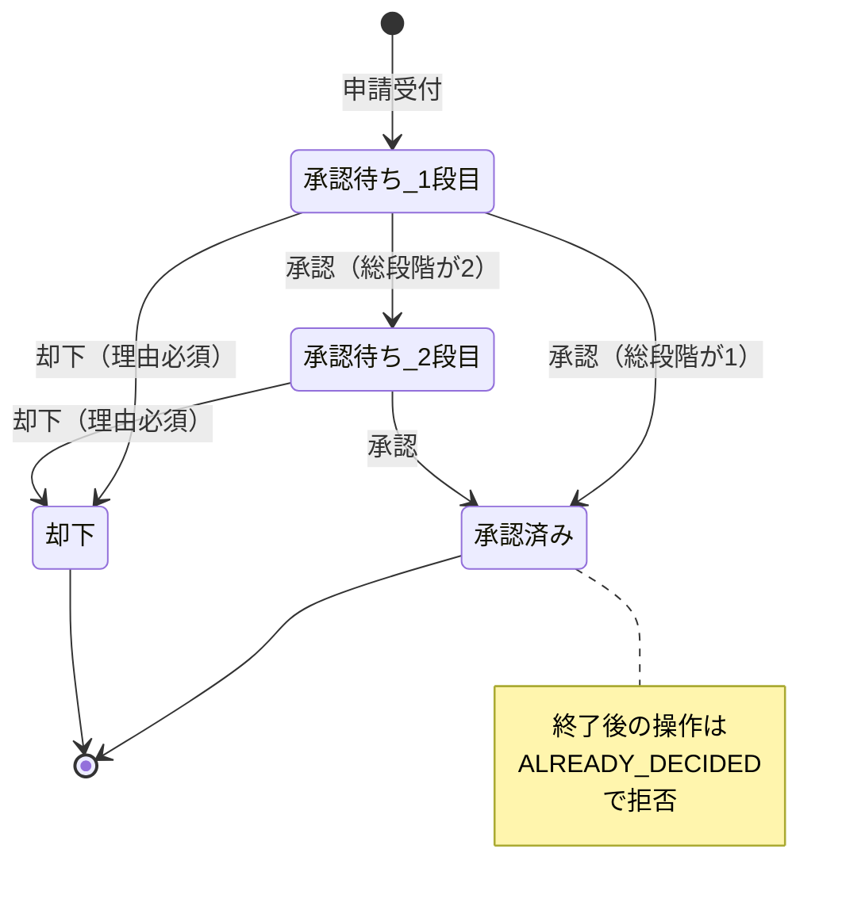
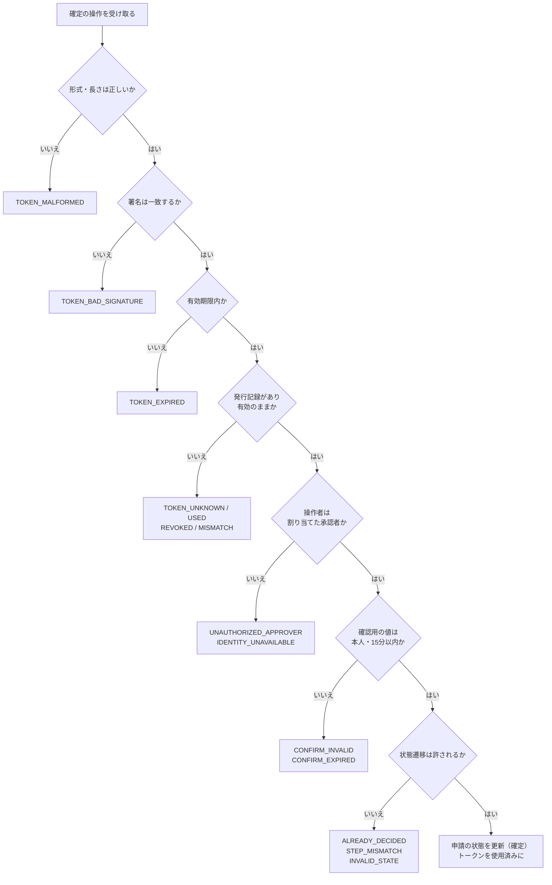

# 詳細設計書

## 文書情報

| 項目 | 内容 |
|------|------|
| 文書名 | 詳細設計書（経費・備品購入申請の承認フロー） |
| 版 | 1.12 |
| 作成日 | 2026-11-15 |

## 改版履歴

| 版 | 日付 | 内容 |
|----|------|------|
| 1.0 | 2026-11-15 | 初版作成 |
| 1.1 | 2026-11-15 | 例外表に INVALID_APPLICANT・督促の最短間隔・通知の失敗を追加。状態の保存とメール送信の順序を変更（3章） |
| 1.2 | 2026-11-15 | 確定の時点を「申請の状態の更新」とし、その後の処理（トークンの使用済み・監査ログ・ロックの解放）は失敗しても確定を取り消さないことを明記。前の段階のトークンは確認画面の時点で STEP_MISMATCH にする |
| 1.3 | 2026-11-15 | ロックの解放前に SpreadsheetApp.flush() で反映し、失敗は FLUSH_FAILED として成功と扱わないことを追加。確定後に監査ログへ記録できない場合は管理者に知らせることを追加 |
| 1.4 | 2026-11-16 | 6章「エラー一覧」を追加（エラーID ERR-001〜ERR-034。例外表に無かった REQUEST_NOT_FOUND・SHEET_NOT_FOUND・ID_EXHAUSTED と、コードの無い失敗3件を含む） |
| 1.5 | 2026-11-16 | 督促（FN-009）の失敗（BUSY・INVALID_SETTING・FLUSH_FAILED 等）を監査ログに記録すること、トークンの行を flush で確定してから督促メールを送る順序、URL・鍵を確かめてから古いトークンを失効させることを追加（2.1・3章・6章）。確認画面でも状態の値の破損を INVALID_STATE にする（1章・2.2・3章・6章）。例外表の INVALID_SETTING を実装どおり（管理者へのメールは届かず実行ログにだけ残る）に修正 |
| 1.6 | 2026-11-16 | 受付・2段目へ進む確定の承認依頼も、トークンの行を排他制御の中で記録し flush で確定してから送る順序に変更。督促・管理者通知は督促回数・最終通知日時を確定してから送り、送れなければ戻す（3章）。例外表の STEP_MISMATCH の発生箇所を実装どおり「画面表示・確定」に修正し、INVALID_STATE の段階の破損は確定時のみと明記。5章の関数表を更新 |
| 1.7 | 2026-11-16 | 送れなかった承認依頼・督促の新しいトークンを失効させることを追加（3章・5章）。FLUSH_FAILED の行と3章に、どの書き込みが反映されたか確定できない境界と、照合・復旧が運用上必須であることを明記 |
| 1.8 | 2026-11-16 | 送信失敗後の申請一覧の戻し・送れなかったトークンの失効に失敗したときは、監査ログに理由コード（RESTORE_FAILED・REVOKE_FAILED）を残し管理者に照合を依頼することを追加（3章） |
| 1.9 | 2026-11-16 | 督促回数が上限に達した申請では、失効できなかったトークンが次の督促で自動的には失効しないことを明記（3章） |
| 1.10 | 2026-11-16 | 文章を見直し（文のねじれを修正） |
| 1.11 | 2026-11-16 | メール・管理者への知らせの日時の表示の形と、書式・表示形式の設定に失敗したときの扱いを記載 |
| 1.12 | 2026-11-16 | 5章に社員名簿の関数と、自由入力の欄の表示の整え方（toFreeTextLine_・quoteFreeText_・describeRequest_）を追加 |

## 1. 状態遷移（FN-004）

| 現在の状態 | 操作 | 条件 | 次の状態 | 拒否のコード |
|-----------|------|------|----------|-------------|
| 承認待ち（段階 n） | 承認 | n < 総段階、トークンの段階 = n | 承認待ち（段階 n+1） | — |
| 承認待ち（段階 n） | 承認 | n = 総段階、トークンの段階 = n | 承認済み | — |
| 承認待ち（段階 n） | 却下 | トークンの段階 = n | 却下 | — |
| 承認待ち（段階 n） | 承認・却下 | トークンの段階 ≠ n | 変えない | STEP_MISMATCH |
| 承認済み・却下 | 承認・却下 | — | 変えない | ALREADY_DECIDED |
| 上記以外の値 | — | — | 変えない | INVALID_STATE |

状態の判定は排他制御（スクリプトロック）の中で、申請一覧を読み直してから行う。同じ申請に同時に2回の操作が届いても、2回目は読み直した時点で「使用済み」または「処理済み」となり拒否される（REQ-102, REQ-107）。確認画面の表示（FN-005）でも同じく、承認済み・却下は ALREADY_DECIDED、承認待ち・承認済み・却下のどれでもない値は INVALID_STATE とする（壊れた値を「処理済み」と案内しない）。

## 2. トークン方式（FN-003）

### 2.1 承認トークン

| 項目 | 内容 |
|------|------|
| 形式 | `base64url(中身のJSON)` + `.` + `base64url(HMAC-SHA256(前半, 鍵))` |
| 中身 | `v`（形式の版）・`tid`（トークンID・UUID）・`rid`（申請ID）・`step`（段階）・`exp`（有効期限・ミリ秒） |
| 鍵 | スクリプトのプロパティ `APPROVAL_HMAC_SECRET`（64文字の乱数。初期設定で生成。コードとシートには置かない） |
| 有効期限 | 発行から「トークン有効時間」（初期値72時間）。中身の `exp` と、承認トークンシートの有効期限の両方で確認する |
| 日時の表示 | メールと管理者への知らせに書く日時（有効期限など）は、スクリプトのタイムゾーン（`appsscript.json` の `timeZone`）で `yyyy/MM/dd HH:mm:ss` の形にする（シートの表示と同じ形）。書式にできないときは ISO 8601 の形に戻し、例外を投げない。承認トークンの使用日時のセルは、使用時に日時の表示形式にする。表示形式の設定に失敗しても処理を続け、トークンの更新の失敗としては扱わない |
| 1回限り | 承認トークンシートの状態（有効・使用済み・失効）で判定する。確定時に「使用済み」にする。万一「使用済み」にできなくても、申請の状態と段階の確認（ALREADY_DECIDED・STEP_MISMATCH）で再利用は拒否される |
| 承認者の固定 | 承認トークンシートの承認者メールと、画面を開いた人のメール（`Session.getActiveUser().getEmail()`）が一致した場合だけ操作できる。メールを取得できない場合は拒否する |
| 再発行 | 督促のたびに古いトークンを「失効」にして新しいトークンを送る（出回るリンクを常に1本にする）。失効の前にウェブアプリの URL と鍵を確かめ、新しいトークンを作れないときは失効させない。新しいトークンの行は flush で確定してからメールを送る（3章） |
| 比較 | 署名の比較は、比較時間が内容によって変わらない方法で行う |

### 2.2 検証の順序

署名を有効期限より先に確かめるため、有効期限を書き換えたトークンは「期限切れ」ではなく「署名不一致」になる。

### 2.3 確認用の値（CSRF 対策）

| 項目 | 内容 |
|------|------|
| 目的 | 状態を変える操作が、承認者本人が開いた確認画面から、開いてから一定時間内に送られたことを確かめる |
| 作り方 | 確認画面を表示するたびに `期限` + `.` + `HMAC-SHA256("confirm" ＋ トークンID ＋ 操作者のメール ＋ 期限 を縦棒で連結した文字列, 鍵)` を作り、画面の data 属性に入れる |
| 有効時間 | 15分 |
| 保存 | サーバーには保存しない（署名で検証する） |
| 検証 | 確定時に、トークンID・操作者のメール・期限から計算し直して照合する。他人が開いた画面の値・期限を書き換えた値は一致しない |

あわせて、次の設計で他サイトからの操作を防ぐ。

- リンクを開く（GET）だけでは状態を変えない。メールのセキュリティ製品がリンクを先読みしても承認されない。
- 状態を変える操作は `google.script.run` 経由だけで受け付ける。ウェブアプリの X-Frame-Options は既定のまま（他サイトへの埋め込みを許可しない設定を変更しない）。
- 画面は「承認する／却下する」→「確定する」の2回の操作で送信する（REQ-109）。

## 3. 例外表

| コード | 発生箇所 | 原因 | 利用者への表示・処理 | 監査ログ |
|--------|----------|------|----------------------|----------|
| INVALID_INPUT | 申請受付 | 金額が整数でない・範囲外、選択肢にない部署・区分、文字数超過、メールアドレスの形式違い（先頭が英数字でない等） | 登録しない。管理者にメール | 受付・失敗 |
| INVALID_APPLICANT | 申請受付 | 設定の「申請者ドメイン」以外のメールアドレス | 登録しない。管理者にメール | 受付・失敗 |
| NO_RULE | 申請受付 | 一致する承認ルールが無い | 登録しない。管理者にメール | 受付・失敗 |
| SELF_APPROVAL | 申請受付 | 申請者本人以外の承認者がいない | 登録しない。管理者にメール | 受付・失敗 |
| INVALID_RULE | 申請受付 | 承認ルールの値が不正 | 登録しない。管理者にメール | 受付・失敗 |
| INVALID_SETTING | 申請受付・督促 | 設定シートの値が不正 | 処理しない。管理者の宛先も設定シートから読むため、管理者へのメールは送れず、GAS の実行ログ（「管理者への通知に失敗」）にだけ残る | 受付・失敗／督促・失敗（申請IDなし） |
| SECRET_NOT_CONFIGURED | 申請受付・確定・督促 | 鍵が未設定・短すぎる | 受付：登録しない（通知できない申請を作らない）。督促：その申請の督促を失敗にし、古いトークンは失効させない | 受付・失敗／督促・失敗 |
| WEBAPP_URL_NOT_CONFIGURED | 申請受付・督促 | ウェブアプリの URL が未設定・形式違い | 受付：登録しない。督促：その申請の督促を失敗にし、古いトークンは失効させない | 受付・失敗／督促・失敗 |
| UNTRUSTED_CALLER | トリガーの入口 | 登録済みトリガー以外からの呼び出し。督促では、操作者が実行権限の持ち主以外の利用者の場合も含む | 処理しない（例外を投げる） | 拒否・失敗 |
| （督促の最短間隔） | 督促 | 前回の実行から30分未満 | 何もせず終える（skipped） | なし |
| NOT_ADMIN | 初期設定 | 管理者本人以外の実行 | 処理しない | なし |
| TOKEN_MALFORMED / TOKEN_BAD_SIGNATURE / TOKEN_UNKNOWN / TOKEN_MISMATCH | 画面表示・確定 | 形式違い・改ざん・記録なし・取り違え | 「このリンクは無効です」 | 画面表示または拒否・失敗 |
| TOKEN_EXPIRED | 画面表示・確定 | 有効期限切れ | 「有効期限が切れています」 | 同上 |
| TOKEN_USED / ALREADY_DECIDED | 画面表示・確定 | 使用済み・処理済み | 「既に処理済みです」 | 同上 |
| TOKEN_REVOKED | 画面表示・確定 | 督促で再発行され失効 | 「新しいメールのリンクを開いてください」 | 同上 |
| UNAUTHORIZED_APPROVER / IDENTITY_UNAVAILABLE | 画面表示・確定 | 承認者以外・メールを取得できない | 「承認者として確認できませんでした」 | 同上 |
| CONFIRM_INVALID / CONFIRM_EXPIRED | 確定 | 確認用の値が無い・不一致・15分超過 | 「メールのリンクから開き直してください」 | 拒否・失敗 |
| COMMENT_REQUIRED | 確定 | 却下の理由が空 | 「却下の理由を入力してください」 | 拒否・失敗 |
| STEP_MISMATCH | 画面表示・確定 | 段階の取り違え（現在段階の値が壊れている場合を含む） | 「このリンクは無効です」 | 画面表示または拒否・失敗 |
| INVALID_ACTION | 確定 | 操作の種類違い | 「このリンクは無効です」 | 拒否・失敗 |
| INVALID_STATE | 画面表示・確定 | 記録の破損。状態が承認待ち・承認済み・却下以外の値（画面表示・確定）、総段階・現在段階の値が範囲外（確定のみ。現在段階がトークンの段階と異なる場合は先に STEP_MISMATCH になる） | 「このリンクは無効です」 | 画面表示または拒否・失敗 |
| BUSY | 確定・受付・督促 | 排他制御を10秒以内に取れない | 確定：「少し待ってからもう一度押してください」。受付：受付失敗として管理者に連絡。督促：その回は何もせず、次の見回りで行う | 拒否・失敗／受付・失敗／督促・失敗（申請IDなし） |
| FLUSH_FAILED | 確定・受付・督促 | ロック解放前の `SpreadsheetApp.flush()` が失敗（書き込みが反映されたか分からない） | 確定：「保存できたか確認できませんでした」と返し、管理者に照合を依頼。次の承認者への承認依頼は送らない。受付：受付失敗として管理者に連絡し、承認依頼は送らない。督促：申請ごとの記録（トークンの行・督促回数）の確定に失敗したらその申請の督促メール・管理者通知を送らない。その回の最後の確定に失敗したら、その回を失敗として記録し管理者に照合を依頼する。どの処理でも、どの書き込みが反映されたかは確定できない境界がある：申請が「承認待ち」のまま残る、送れなかったトークンが「有効」のまま残る（失効・行の戻しの書き込みが反映されない）ことがありうる。照合と復旧（[07_障害対応手順書](07_障害対応手順書.md) の ERR-031）は運用上必須 | 保存確認・失敗／受付・失敗／督促・失敗（申請ごと、または申請IDなし） |
| （コードなし） | 全体 | 想定外の例外 | 例外をそのまま投げ、GAS の実行ログに残す | 受付・督促では UNEXPECTED を記録してから投げる |

状態の保存とメール送信の順序：

- 受付・承認・却下では、排他制御の中で状態（申請の登録、トークンの使用済み、申請の状態）を保存して監査ログに記録し、排他制御を解いた後にメールを送る。
  - 承認依頼（受付後の1段目、2段目へ進んだときの次の承認者）のトークンの行も、同じ排他制御の中で記録する。ロックの解放前の flush で状態と一緒に確定し、確定してから送る（届いたリンクが TOKEN_UNKNOWN にならないようにする）。flush に失敗した場合は送らず、FLUSH_FAILED の扱い（受付失敗・保存確認の失敗として管理者に照合を依頼）になる。
  - トークンの発行に失敗しても（設定の読み取りの失敗など）、確定した登録・状態は取り消さない。排他制御を解いた後に「通知・失敗」として記録し管理者に知らせる。
  - 承認依頼を送れなかった場合は、改めて排他制御を取り、そのトークンを「失効」にする（解放前の flush で確定）。排他制御を取れない・確定できない場合も処理は止めず、残った「有効」の行は次の督促で失効する（督促回数が上限に達している申請は督促されず管理者通知に進むため、自動では失効しない。REVOKE_FAILED の照合依頼を受けて管理者が「失効」にする）。
- 確定の時点は「申請の登録」（受付）と「申請の状態の更新」（承認・却下）とする。ここで失敗した場合だけ利用者に失敗を返す。その後のトークンの使用済み・監査ログの記録・ロックの解放・メール送信は、失敗しても確定を取り消さず、実行ログ（記録できる場合は監査ログ）に残す。督促と初期設定の監査ログも同じ扱いにする。
- 確定後に監査ログへ記録できなかった場合は、実行ログに加えて、日時・申請ID・操作・実行者・結果を管理者にメールで知らせる（知らせられなくても処理は止めない）。管理者は手順書の「障害時の対応」に従って監査ログに追記する。
- 排他制御の中の書き込みは、ロックを解放する前に `SpreadsheetApp.flush()` で反映する（公式リファレンスの推奨）。flush が失敗した場合は成功として扱わず、ロックを解放してから FLUSH_FAILED を返す。
  - このとき、書き込みは「すべて反映された」「一部だけ反映された」「反映されていない」のどれもありうるものとして扱う。
  - 承認・却下は、反映されていれば同じリンクで「処理済み」に、反映されていなければもう一度操作できる（状態とトークンの確認で二重処理にはならない）。申請一覧と承認トークンの片方だけが反映された場合も、申請の状態が更新されていれば再操作は拒否され、更新されていなければ再操作で確定する。
  - 受付は、申請一覧に登録されていれば督促で承認依頼が送られる。登録されていなければ申請者に再申請を依頼する。
  - どの場合も監査ログの成功行は信頼せず、管理者が申請一覧・承認トークン・監査ログを照合する。
  - 反映された書き込みをプログラムから確かめる方法は無いため、申請が「承認待ち」のまま残る・送れなかったトークンが「有効」のまま残るといった状態は、この境界では避けられない。照合と復旧は運用上必須とする。
- メールが送れなくても状態は戻さない。監査ログに「通知・失敗」を記録し、管理者にメールで知らせる。利用者には「承認しました。…通知に失敗したため、管理者に連絡しました」と、確定したことを返す。
- 承認待ちの申請（受付直後・2段目へ進んだ直後）は、督促（最後の通知から督促開始時間の経過後）で新しいリンクが送られて回復する。最終の結果メールは督促の対象ではないため、管理者が申請者に連絡する（[06_導入・運用手順](06_導入・運用手順.md) の4章）。
- 督促の途中で1件失敗した場合：その申請だけ「督促・失敗」を記録し、他の申請の督促は続ける。失敗した申請は最終通知日時を更新しないため、次の見回りで再び督促する。
- 督促は排他制御の中で、1件ずつ次の順に行う：ウェブアプリの URL と鍵の確認 → 古いトークンの失効 → 新しいトークンの記録 → 督促回数・最終通知日時の更新 → `SpreadsheetApp.flush()` で確定 → 督促メールの送信 → 監査ログ。督促上限に達した申請の管理者通知も、督促回数（上限＋1）を更新して flush で確定してから送る。
  - 送った督促・管理者通知の記録を確定してから送るため、その回の最後の flush が失敗しても、次の見回りで同じ督促・知らせが重複しない。
  - 確定（flush）または送信に失敗した場合は、申請一覧の行を送信前の値に戻し、その申請を失敗にする（次の見回りで再び試す）。督促では、送れなかった新しいトークンも「失効」にする（古いトークンは失効のまま有効に戻さない）。戻した値と失効はその回の最後の flush で確定する。
  - 戻し・失効の書き込み自体に失敗した場合は処理を止めず、監査ログの詳細に理由コード（戻しは RESTORE_FAILED、失効は REVOKE_FAILED）を残し、管理者に照合を依頼する（戻す値・申請ID・段階を知らせる。トークンの文字列・トークンIDは載せない）。受付・確定の後の失効で排他制御を取れない・確定できない場合も REVOKE_FAILED とする。
  - URL・鍵が不備なら、古いトークンを失効させる前に止める（承認者の手元のリンクを使えなくしない）。
  - 確定（flush）に失敗した申請には督促メールを送らない（届いたリンクが TOKEN_UNKNOWN にならないようにする）。flush はロックの解放前に行う規約のとおり、排他制御の中で呼ぶ。
- 督促のその回全体が失敗した場合（BUSY・INVALID_SETTING・その回の最後の flush の失敗など）は、例外で終わらせず、監査ログに申請IDなしの「督促・失敗」を記録する。記録できない場合は、確定後の記録と同じく管理者にメールで知らせる。FLUSH_FAILED のときは管理者に照合を依頼する。想定外の例外は記録してから例外を投げる。

## 4. ログ方針

| 項目 | 方針 |
|------|------|
| 記録先 | 監査ログシート（追記のみ）。GAS の実行ログは想定外の例外の調査用 |
| 記録する操作 | 受付・承認・却下・督促・管理者通知・画面表示の失敗・拒否・初期設定 |
| 実行者 | 操作者のメール（正規化済み）。トリガーは `system`、確認できない場合は `unknown` |
| 書かない情報 | トークンの文字列・署名・鍵・確認用の値。却下理由の本文は申請者への通知メールにだけ書き、ログには「コメントあり」とだけ書く |
| 改ざん抑止 | プログラムから既存行を書き換えない。シートの保護で管理者以外を編集不可にする（[06_導入・運用手順](06_導入・運用手順.md)） |
| 数式の無効化 | 利用者が入力した文字列が `=` `+` `-` `@` で始まる場合は先頭に `'` を付けて書く（シートで数式として動かさない） |
| 保管期間 | 本リポジトリでは定めない。導入先の規程に合わせて、年1回シートを別ファイルに移す運用を想定する |

## 5. 主な関数（`src/`）

| 関数 | 種別 | 内容 |
|------|------|------|
| `parseFormResponse_` `parseAmount_` | 純粋 | フォーム回答の検査（FN-001） |
| `parseRules_` `parseSettings_` `resolveApprovalRoute_` | 純粋 | 承認経路の決定（FN-002） |
| `buildTokenClaims_` `signToken_` `verifyToken_` `checkTokenRecord_` `checkApproverIdentity_` | 純粋 | トークン（FN-003） |
| `createConfirmNonce_` `verifyConfirmNonce_` | 純粋 | 確認用の値（FN-005, FN-006） |
| `transition_` | 純粋 | 状態遷移（FN-004） |
| `selectReminders_` | 純粋 | 督促対象の選定（FN-008） |
| `parseEmployeeNames_` `applicantLabel_` `stripControlChars_` `toDisplayLine_` `truncateChars_` | 純粋 | 社員名簿の解釈、申請者の表示「氏名（メールアドレス）」の作成、表示する文字の整え方（FN-005, FN-007） |
| `toFreeTextLine_` `quoteFreeText_` `describeRequest_` | 純粋 | 自由入力の欄（品目・内容、理由、承認者のコメント）の表示の整え方と、メールの申請内容の作成。品目・内容は1行、理由・コメントは各行の先頭に「> 」（FN-005, FN-007。[02_基本設計](02_基本設計.md) の4.8） |
| `readEmployeeNames_` `readEmployeeNamesSafely_` `withApplicantName_` | 入出力 | 社員名簿の読み取り（シートが無ければ空。読めなければ実行ログにエラーコードだけを残して空）と、表示用に氏名を付けた申請の写しの作成。督促では1回の実行で名簿を1回だけ読む（FN-005, FN-007, FN-009） |
| `handleFormSubmit_` `renderDecisionView_` `handleDecision_` `handleReminders_` `handleSetup_` | 入出力 | 各入口の処理の組み立て |
| `issueToken_` `tryIssueToken_` `sendIssued_` `restoreRequestSafely_` `revokeTokenSafely_` `revokeUnsentToken_` `flushOrThrow_` | 入出力 | トークンの発行と記録（排他制御の中）・承認依頼の送信（排他制御の外）・送信失敗時の申請一覧の戻しと送れなかったトークンの失効・ロック解放前の書き込みの反映 |
| `assertTriggerEvent_` `assertFormSubmitEvent_` `assertTimeEvent_` `assertAdmin_` | 入出力 | 呼び出し元の検証（FN-012） |

## 6. エラー一覧

コード上のエラー（`approvalError_` で投げるエラーコード）と、エラーコードを持たないが記録と管理者への知らせを行う失敗に、エラーIDを付ける。対応の手順は [07_障害対応手順書](07_障害対応手順書.md) の同じエラーIDの節に記す。利用者への表示の文言は `src/View.ts` の `userMessageFor_` による（一覧にない表示は「このリンクは無効です。」）。

| エラーID | コード | 名称 | 発生する処理 | 利用者・管理者に見えるもの |
|----------|--------|------|--------------|----------------------------|
| ERR-001 | INVALID_INPUT | 入力内容の不正 | FN-001 | 管理者に「申請を受け付けられませんでした」のメール |
| ERR-002 | INVALID_APPLICANT | 申請者ドメイン外のアドレス | FN-001 | 同上 |
| ERR-003 | NO_RULE | 一致する承認ルールが無い | FN-001, FN-002 | 同上 |
| ERR-004 | SELF_APPROVAL | 申請者本人以外の承認者がいない | FN-001, FN-002 | 同上 |
| ERR-005 | INVALID_RULE | 承認ルールの値の不正 | FN-001, FN-002 | 同上 |
| ERR-006 | INVALID_SETTING | 設定の値の不正 | FN-001, FN-009, FN-011 | 受付：監査ログに「受付・失敗」。督促：監査ログに「督促・失敗」（申請IDなし）。管理者の宛先も設定から読むため、管理者へのメールは届かない（実行ログにだけ残る） |
| ERR-007 | SECRET_NOT_CONFIGURED | 署名用の鍵が未設定 | FN-001, FN-003, FN-005, FN-006, FN-009 | 受付：管理者に受付失敗のメール。画面：「このリンクは無効です。」。督促：監査ログに「督促・失敗」（古いリンクは失効させない） |
| ERR-008 | WEBAPP_URL_NOT_CONFIGURED | ウェブアプリの URL が未設定 | FN-001, FN-009 | 受付：管理者に受付失敗のメール。督促：監査ログに「督促・失敗」（古いリンクは失効させない） |
| ERR-009 | ID_EXHAUSTED | 申請IDの採番の上限 | FN-001 | 同上 |
| ERR-010 | SHEET_NOT_FOUND | シートが見つからない | 全体 | 処理による（[07_障害対応手順書](07_障害対応手順書.md) の該当節） |
| ERR-011 | UNTRUSTED_CALLER | トリガー以外からの呼び出し | FN-001, FN-009, FN-012 | 監査ログに「拒否・失敗」。処理は行わない |
| ERR-012 | NOT_ADMIN | 管理者以外による初期設定 | FN-011, FN-012 | エディタの実行結果にエラー |
| ERR-013 | TOKEN_MALFORMED | リンクの形式の不正 | FN-003, FN-005, FN-006 | 「このリンクは無効です。」 |
| ERR-014 | TOKEN_BAD_SIGNATURE | リンクの署名の不一致 | FN-003, FN-005, FN-006 | 「このリンクは無効です。」 |
| ERR-015 | TOKEN_EXPIRED | リンクの有効期限切れ | FN-003, FN-005, FN-006 | 「このリンクは有効期限が切れています。…」 |
| ERR-016 | TOKEN_UNKNOWN | リンクの発行記録が無い | FN-003, FN-005, FN-006 | 「このリンクは無効です。」 |
| ERR-017 | TOKEN_USED | 使用済みのリンク | FN-003, FN-005, FN-006 | 「この申請は既に処理済みです。」 |
| ERR-018 | TOKEN_REVOKED | 失効したリンク | FN-003, FN-005, FN-006 | 「このリンクは無効になっています。…」 |
| ERR-019 | TOKEN_MISMATCH | リンクと発行記録の不一致 | FN-003, FN-005, FN-006 | 「このリンクは無効です。」 |
| ERR-020 | UNAUTHORIZED_APPROVER | 承認者以外の操作 | FN-003, FN-005, FN-006 | 「この申請の承認者として確認できませんでした。…」 |
| ERR-021 | IDENTITY_UNAVAILABLE | 操作者のメールアドレスを取得できない | FN-003, FN-005, FN-006 | 同上 |
| ERR-022 | REQUEST_NOT_FOUND | 申請が見つからない | FN-005, FN-006 | 「このリンクは無効です。」 |
| ERR-023 | ALREADY_DECIDED | 処理済みの申請 | FN-004, FN-005, FN-006 | 「この申請は既に処理済みです。」 |
| ERR-024 | STEP_MISMATCH | 承認段階の不一致 | FN-004, FN-005, FN-006 | 「このリンクは無効です。」 |
| ERR-025 | INVALID_STATE | 申請の状態の記録の不正 | FN-004, FN-005, FN-006 | 「このリンクは無効です。」 |
| ERR-026 | INVALID_ACTION | 操作の種類の不正 | FN-004, FN-006 | 「このリンクは無効です。」 |
| ERR-027 | COMMENT_REQUIRED | 却下の理由が空 | FN-005, FN-006 | 「却下の理由を入力してください。」 |
| ERR-028 | CONFIRM_INVALID | 確認用の値の不正 | FN-006 | 「確認画面から操作してください。…」 |
| ERR-029 | CONFIRM_EXPIRED | 確認画面の有効時間切れ | FN-006 | 「画面を開いてから時間が経ちました。…」 |
| ERR-030 | BUSY | 排他制御の待ち時間切れ | FN-001, FN-006, FN-009 | 確定：「他の処理と重なりました。…」。受付：管理者に受付失敗のメール。督促：監査ログに「督促・失敗」（申請IDなし） |
| ERR-031 | FLUSH_FAILED | 書き込みの反映の確認失敗 | FN-001, FN-006, FN-009 | 確定：「保存できたか確認できませんでした。…」と管理者へのメール。受付：管理者に受付失敗のメール。督促：監査ログに「督促・失敗」と、その回の最後の確定の失敗なら管理者に「督促の保存を確認できませんでした」のメール |
| ERR-032 | （コードなし） | 通知メールの送信失敗 | FN-001, FN-006, FN-007, FN-009 | 管理者に「通知メールを送れませんでした」のメール。確定の画面に「…通知に失敗したため、管理者に連絡しました。」 |
| ERR-033 | （コードなし） | トークンの使用済みへの更新失敗 | FN-006 | 監査ログに「トークン更新・失敗」。利用者への表示は成功のまま |
| ERR-034 | （コードなし） | 監査ログへの記録失敗 | FN-010 | 管理者に「監査ログに記録できませんでした」のメール |

- ERR-032〜ERR-034 は、確定した処理を取り消さない失敗である（3章「状態の保存とメール送信の順序」）。監査ログの詳細の欄には、原因となった例外のコード（想定外の例外なら `UNEXPECTED`）を書く。
- エラーIDの付かない障害（想定外の例外・Google 側の停止など）は [07_障害対応手順書](07_障害対応手順書.md) の5章で扱う。
