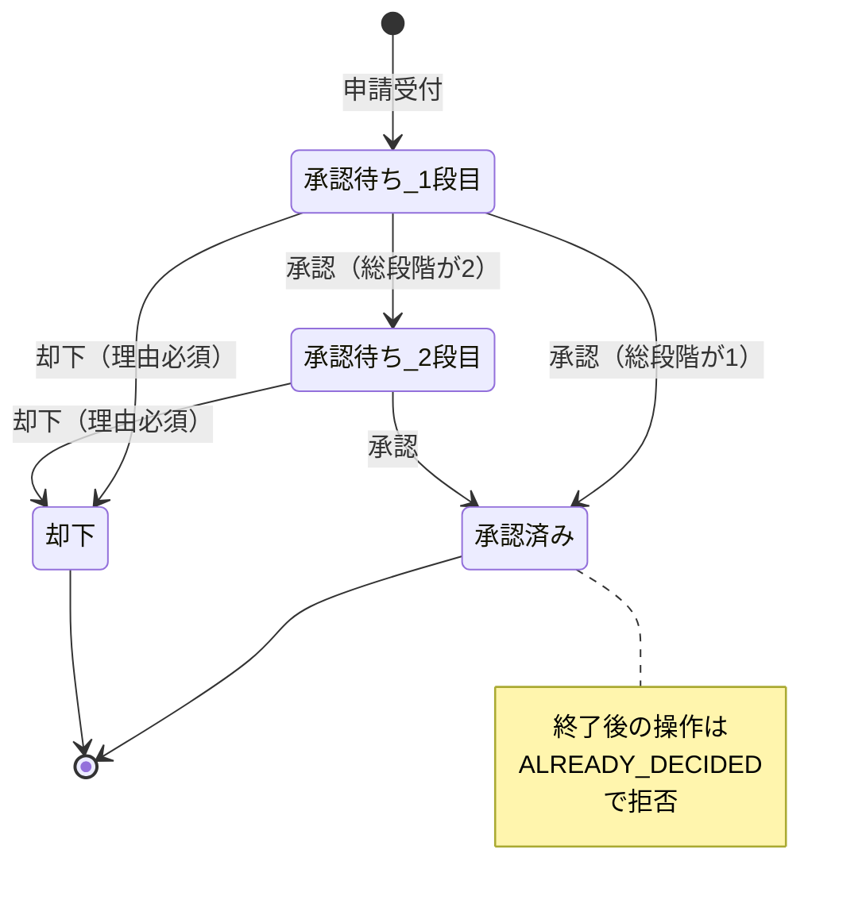
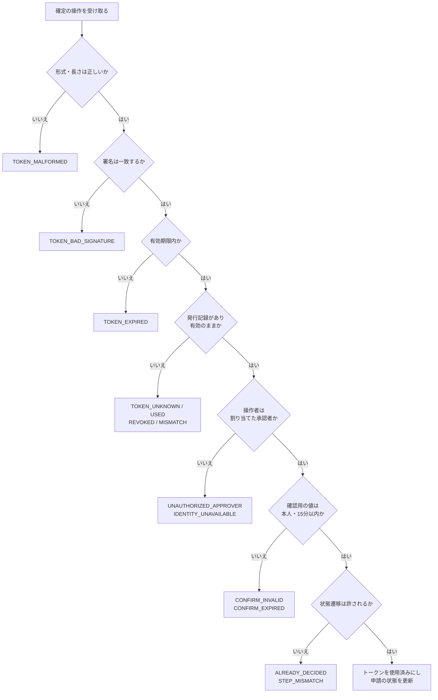

# 詳細設計書

## 文書情報

| 項目 | 内容 |
|------|------|
| 文書名 | 詳細設計書（経費・備品購入申請の承認フロー） |
| 版 | 1.1 |
| 作成日 | 2026-11-15 |

## 改版履歴

| 版 | 日付 | 内容 |
|----|------|------|
| 1.0 | 2026-11-15 | 初版作成 |
| 1.1 | 2026-11-15 | 例外表に INVALID_APPLICANT・督促の最短間隔・通知の失敗を追加。状態の保存とメール送信の順序を変更（3章） |

## 1. 状態遷移（FN-004）

| 現在の状態 | 操作 | 条件 | 次の状態 | 拒否のコード |
|-----------|------|------|----------|-------------|
| 承認待ち（段階 n） | 承認 | n < 総段階、トークンの段階 = n | 承認待ち（段階 n+1） | — |
| 承認待ち（段階 n） | 承認 | n = 総段階、トークンの段階 = n | 承認済み | — |
| 承認待ち（段階 n） | 却下 | トークンの段階 = n | 却下 | — |
| 承認待ち（段階 n） | 承認・却下 | トークンの段階 ≠ n | 変えない | STEP_MISMATCH |
| 承認済み・却下 | 承認・却下 | — | 変えない | ALREADY_DECIDED |
| 上記以外の値 | — | — | 変えない | INVALID_STATE |

状態の判定は排他制御（スクリプトロック）の中で、申請一覧を読み直してから行う。同じ申請に同時に2回の操作が届いても、2回目は読み直した時点で「使用済み」または「処理済み」となり拒否される（REQ-102, REQ-107）。

## 2. トークン方式（FN-003）

### 2.1 承認トークン

| 項目 | 内容 |
|------|------|
| 形式 | `base64url(中身のJSON)` + `.` + `base64url(HMAC-SHA256(前半, 鍵))` |
| 中身 | `v`（形式の版）・`tid`（トークンID・UUID）・`rid`（申請ID）・`step`（段階）・`exp`（有効期限・ミリ秒） |
| 鍵 | スクリプトのプロパティ `APPROVAL_HMAC_SECRET`（64文字の乱数。初期設定で生成。コードとシートには置かない） |
| 有効期限 | 発行から「トークン有効時間」（初期値72時間）。中身の `exp` と、承認トークンシートの有効期限の両方で確認する |
| 1回限り | 承認トークンシートの状態（有効・使用済み・失効）で判定する。確定時に「使用済み」にする |
| 承認者の固定 | 承認トークンシートの承認者メールと、画面を開いた人のメール（`Session.getActiveUser().getEmail()`）が一致した場合だけ操作できる。メールを取得できない場合は拒否する |
| 再発行 | 督促のたびに古いトークンを「失効」にして新しいトークンを送る（出回るリンクを常に1本にする） |
| 比較 | 署名の比較は、比較時間が内容によって変わらない方法で行う |

### 2.2 検証の順序

署名を有効期限より先に確かめるため、有効期限を書き換えたトークンは「期限切れ」ではなく「署名不一致」になる。

### 2.3 確認用の値（CSRF 対策）

| 項目 | 内容 |
|------|------|
| 目的 | 状態を変える操作が、承認者本人が開いた確認画面から、開いてから一定時間内に送られたことを確かめる |
| 作り方 | 確認画面を表示するたびに `期限` + `.` + `HMAC-SHA256("confirm" ＋ トークンID ＋ 操作者のメール ＋ 期限 を縦棒で連結した文字列, 鍵)` を作り、画面の data 属性に入れる |
| 有効時間 | 15分 |
| 保存 | サーバーには保存しない（署名で検証する） |
| 検証 | 確定時に、トークンID・操作者のメール・期限から計算し直して照合する。他人が開いた画面の値・期限を書き換えた値は一致しない |

あわせて、次の設計で他サイトからの操作を防ぐ。

- リンクを開く（GET）だけでは状態を変えない。メールのセキュリティ製品がリンクを先読みしても承認されない。
- 状態を変える操作は `google.script.run` 経由だけで受け付ける。ウェブアプリの X-Frame-Options は既定のまま（他サイトへの埋め込みを許可しない設定を変更しない）。
- 画面は「承認する／却下する」→「確定する」の2回の操作で送信する（REQ-109）。

## 3. 例外表

| コード | 発生箇所 | 原因 | 利用者への表示・処理 | 監査ログ |
|--------|----------|------|----------------------|----------|
| INVALID_INPUT | 申請受付 | 金額が整数でない・範囲外、選択肢にない部署・区分、文字数超過、メールアドレスの形式違い（先頭が英数字以外を含む） | 登録しない。管理者にメール | 受付・失敗 |
| INVALID_APPLICANT | 申請受付 | 設定の「申請者ドメイン」以外のメールアドレス | 登録しない。管理者にメール | 受付・失敗 |
| NO_RULE | 申請受付 | 一致する承認ルールが無い | 登録しない。管理者にメール | 受付・失敗 |
| SELF_APPROVAL | 申請受付 | 申請者本人以外の承認者がいない | 登録しない。管理者にメール | 受付・失敗 |
| INVALID_RULE / INVALID_SETTING | 申請受付・督促 | 承認ルール・設定シートの値が不正 | 処理しない。管理者にメール | 受付・失敗 |
| SECRET_NOT_CONFIGURED | 申請受付・確定 | 鍵が未設定・短すぎる | 登録しない（通知できない申請を作らない） | 受付・失敗 |
| WEBAPP_URL_NOT_CONFIGURED | 申請受付 | ウェブアプリの URL が未設定・形式違い | 登録しない | 受付・失敗 |
| UNTRUSTED_CALLER | トリガーの入口 | 登録済みトリガー以外からの呼び出し。督促では、操作者が実行権限の持ち主以外の利用者の場合も含む | 処理しない（例外を投げる） | 拒否・失敗 |
| （督促の最短間隔） | 督促 | 前回の実行から30分未満 | 何もせず終える（skipped） | なし |
| NOT_ADMIN | 初期設定 | 管理者本人以外の実行 | 処理しない | なし |
| TOKEN_MALFORMED / TOKEN_BAD_SIGNATURE / TOKEN_UNKNOWN / TOKEN_MISMATCH | 画面表示・確定 | 形式違い・改ざん・記録なし・取り違え | 「このリンクは無効です」 | 画面表示または拒否・失敗 |
| TOKEN_EXPIRED | 画面表示・確定 | 有効期限切れ | 「有効期限が切れています」 | 同上 |
| TOKEN_USED / ALREADY_DECIDED | 画面表示・確定 | 使用済み・処理済み | 「既に処理済みです」 | 同上 |
| TOKEN_REVOKED | 画面表示・確定 | 督促で再発行され失効 | 「新しいメールのリンクを開いてください」 | 同上 |
| UNAUTHORIZED_APPROVER / IDENTITY_UNAVAILABLE | 画面表示・確定 | 承認者以外・メールを取得できない | 「承認者として確認できませんでした」 | 同上 |
| CONFIRM_INVALID / CONFIRM_EXPIRED | 確定 | 確認用の値が無い・不一致・15分超過 | 「メールのリンクから開き直してください」 | 拒否・失敗 |
| COMMENT_REQUIRED | 確定 | 却下の理由が空 | 「却下の理由を入力してください」 | 拒否・失敗 |
| STEP_MISMATCH / INVALID_ACTION / INVALID_STATE | 確定 | 段階の取り違え・操作の種類違い・記録の破損 | 「このリンクは無効です」 | 拒否・失敗 |
| BUSY | 確定・受付・督促 | 排他制御を10秒以内に取れない | 「少し待ってからもう一度押してください」 | 拒否・失敗 |
| （コードなし） | 全体 | 想定外の例外 | 例外をそのまま投げ、GAS の実行ログに残す | 受付時は UNEXPECTED |

状態の保存とメール送信の順序：

- 受付・承認・却下では、排他制御の中で状態（申請の登録、トークンの使用済み、申請の状態）を保存して監査ログに記録し、排他制御を解いた後にメールを送る。
- メールが送れなくても状態は戻さない。監査ログに「通知・失敗」を記録し、管理者にメールで知らせる。利用者には「承認しました。…通知に失敗したため、管理者に連絡しました」と、確定したことを返す。
- 承認待ちの申請（受付直後・2段目へ進んだ直後）は、督促（最後の通知から督促開始時間の経過後）で新しいリンクが送られて回復する。最終の結果メールは督促の対象ではないため、管理者が申請者に連絡する（[06_導入・運用手順](06_導入・運用手順.md) の4章）。
- 督促の途中で1件失敗した場合：その申請だけ「督促・失敗」を記録し、他の申請の督促は続ける。失敗した申請は最終通知日時を更新しないため、次の見回りで再び督促する。

## 4. ログ方針

| 項目 | 方針 |
|------|------|
| 記録先 | 監査ログシート（追記のみ）。GAS の実行ログは想定外の例外の調査用 |
| 記録する操作 | 受付・承認・却下・督促・管理者通知・画面表示の失敗・拒否・初期設定 |
| 実行者 | 操作者のメール（正規化済み）。トリガーは `system`、確認できない場合は `unknown` |
| 書かない情報 | トークンの文字列・署名・鍵・確認用の値。却下理由の本文は申請者への通知メールにだけ書き、ログには「コメントあり」とだけ書く |
| 改ざん抑止 | プログラムから既存行を書き換えない。シートの保護で管理者以外を編集不可にする（[06_導入・運用手順](06_導入・運用手順.md)） |
| 数式の無効化 | 利用者が入力した文字列が `=` `+` `-` `@` で始まる場合は先頭に `'` を付けて書く（シートで数式として動かさない） |
| 保管期間 | 本リポジトリでは定めない。導入先の規程に合わせて、年1回シートを別ファイルに移す運用を想定する |

## 5. 主な関数（`src/`）

| 関数 | 種別 | 内容 |
|------|------|------|
| `parseFormResponse_` `parseAmount_` | 純粋 | フォーム回答の検査（FN-001） |
| `parseRules_` `parseSettings_` `resolveApprovalRoute_` | 純粋 | 承認経路の決定（FN-002） |
| `buildTokenClaims_` `signToken_` `verifyToken_` `checkTokenRecord_` `checkApproverIdentity_` | 純粋 | トークン（FN-003） |
| `createConfirmNonce_` `verifyConfirmNonce_` | 純粋 | 確認用の値（FN-005, FN-006） |
| `transition_` | 純粋 | 状態遷移（FN-004） |
| `selectReminders_` | 純粋 | 督促対象の選定（FN-008） |
| `handleFormSubmit_` `renderDecisionView_` `handleDecision_` `handleReminders_` `handleSetup_` | 入出力 | 各入口の処理の組み立て |
| `assertTriggerEvent_` `assertFormSubmitEvent_` `assertTimeEvent_` `assertAdmin_` | 入出力 | 呼び出し元の検証（FN-012） |
