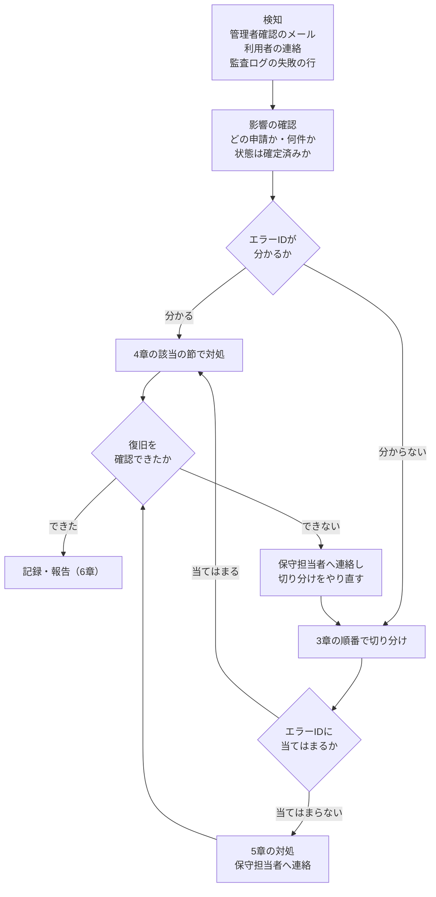

# 障害対応手順書

## 文書情報

| 項目 | 内容 |
|------|------|
| 文書名 | 障害対応手順書（経費・備品購入申請の承認フロー） |
| 文書ID | OP-INC-001 |
| システム名 | 経費・備品購入申請の承認フロー |
| 版 | 1.2 |
| 作成日 | 2026-11-16 |
| 状態 | 承認済 |

## 改版履歴

| 版 | 日付 | 内容 |
|----|------|------|
| 1.0 | 2026-11-16 | 新規作成 |
| 1.1 | 2026-11-16 | 督促の失敗の記録（申請IDなしの「督促・失敗」・管理者への照合の依頼）、トークンの行を確定してから督促メールを送る順序、URL・鍵の不備では古いリンクを失効させない動き、確認画面での INVALID_STATE に合わせて 3.1・3.2・ERR-006〜ERR-008・ERR-010・ERR-016・ERR-018・ERR-023・ERR-025・ERR-030・ERR-031・ERR-034・5章・7章を更新 |
| 1.2 | 2026-11-16 | 受付・2段目への承認依頼もトークンの行を確定してから送る順序、督促・管理者通知は記録を確定してから送り送れなければ戻す動きに合わせて ERR-016・ERR-024・ERR-025・ERR-031・ERR-032・7章を更新 |

> この手順は、本リポジトリの作成時には実際の Google 環境で**実施していない（未実施）**。動きの記述はソースコード（`src/`）と自動テストに基づく。画面の名称は導入時の画面で確認すること。

## 1. 目的と対象

| 項目 | 内容 |
|------|------|
| 目的 | 本システムで障害が起きたときに、影響を確かめ、原因を切り分け、データを壊さずに復旧するための手順を定める |
| 使う人 | 運用担当者（管理者。[04_権限設計](04_権限設計.md) の ROLE-03）。コードの修正・配置が必要な場合は保守担当者 |
| 使うとき | 管理者に件名の先頭が `【管理者確認】` のメールが届いたとき。利用者（申請者・承認者）から「申請が届かない」「リンクが開けない」等の連絡を受けたとき。定期点検（[06_導入・運用手順](06_導入・運用手順.md) の5章）で監査ログに「失敗」の行を見つけたとき |
| 対象 | Google フォーム、スプレッドシート（`フォームの回答 1` `申請一覧` `承認ルール` `設定` `承認トークン` `監査ログ`）、Apps Script（トリガー・ウェブアプリ・スクリプトのプロパティ） |
| 対象外 | Google のサービスそのものの障害の復旧、申請内容の業務上の判断、導入先の社内規程に基づく報告の手続き |

エラーIDとコードの一覧は [03_詳細設計](03_詳細設計.md) の6章にある。

## 2. 障害時の基本の流れ



- 影響の確認では、最初に「申請の状態が確定済みか」を確かめる。本システムは状態の保存を先に行い、メール送信・監査ログの記録はその後に行う（[03_詳細設計](03_詳細設計.md) の3章）。確定後の失敗では状態を戻さない。
- 申請一覧・承認トークンを手で直す前に、直す前の値を控える（6章の記録に残す）。

## 3. 切り分けの順番

上から順に確かめる。どこで止まっているかが分かった時点で、4章の該当の節に進む。

### 3.1 管理者へのメール

件名の先頭には `【管理者確認】` が付く。

| 件名（先頭の括弧書きの後） | 意味 | エラーID |
|----------------------------|------|----------|
| 申請を受け付けられませんでした | 受付の失敗。本文の「理由コード」で判断する | 理由コードに対応（ERR-001〜ERR-010、ERR-030、ERR-031。`UNEXPECTED` は5章） |
| 通知メールを送れませんでした（申請ID） | 状態は確定済み。通知だけ失敗 | ERR-032 |
| 承認・却下の保存を確認できませんでした（申請ID） | 書き込みが反映されたか分からない | ERR-031 |
| 督促の保存を確認できませんでした | 督促の回の最後の書き込みが反映されたか分からない（督促メールは送信済みのことがある） | ERR-031 |
| 監査ログに記録できませんでした（申請ID） | 処理は完了。監査ログの行が欠けた | ERR-034 |
| 督促しても承認されていない申請（申請ID） | 督促上限回数を超えた（障害ではない） | なし（[06_導入・運用手順](06_導入・運用手順.md) の3章「承認者の不在」） |

設定シートの管理者メールが読めない場合（ERR-006）は、これらのメールは届かない。

### 3.2 監査ログ

`監査ログ` の列は「日時・申請ID・操作・実行者・結果・詳細」。結果が「失敗」の行を、日時の新しい順に見る。

| 操作 | 詳細 | 意味 | エラーID |
|------|------|------|----------|
| 受付 | エラーコード | 申請を受け付けていない（FLUSH_FAILED の場合は登録済みの可能性あり） | 詳細のコードに対応 |
| 拒否 | UNTRUSTED_CALLER（実行者 `unknown`） | トリガー以外からの呼び出しを拒否 | ERR-011 |
| 拒否 | その他のコード | 確定の操作を拒否 | 詳細のコードに対応 |
| 画面表示 | エラーコード | 確認画面を出さずに案内を表示 | 詳細のコードに対応 |
| 保存確認 | FLUSH_FAILED | 承認・却下の書き込みの反映を確認できなかった | ERR-031 |
| 通知 | 原因のコード | 承認依頼・結果のメールを送れなかった | ERR-032 |
| 督促（申請IDあり） | 原因のコード | その申請の督促に失敗した（次の見回りで再び試す） | ERR-032（`WEBAPP_URL_NOT_CONFIGURED` なら ERR-008、`SECRET_NOT_CONFIGURED` なら ERR-007、`FLUSH_FAILED` なら ERR-031） |
| 督促（申請IDなし） | エラーコード | その回の督促が行われなかった、または最後の保存を確認できなかった | 詳細のコードに対応（`BUSY` は ERR-030、`INVALID_SETTING` は ERR-006、`FLUSH_FAILED` は ERR-031、`UNEXPECTED` は5章） |
| 管理者通知 | 原因のコード | 督促上限超過の知らせを送れなかった | ERR-032 |
| トークン更新 | 原因のコード | 確定後にトークンを使用済みにできなかった | ERR-033 |

あわせて、失敗の行が無くても次を確かめる。

- 督促の行が長時間無い：トリガーが動いていない可能性（5章）。ERR-006・ERR-030・ERR-031 で止まった回は、申請IDの無い「督促・失敗」の行が残る。督促は期限の来た申請が無ければ行を記録しないため、承認待ちの申請の最終通知日時と比べて判断する。
- 「初期設定・成功」の行：詳細に「署名用の鍵」があれば、その日時に鍵を作り直している（ERR-014）。

### 3.3 申請一覧・承認トークン

申請IDで行を探し、次を見る。

| シート | 見る列 | 確かめること |
|--------|--------|--------------|
| 申請一覧 | 状態・現在段階・総段階 | 確定済みか。値が壊れていないか（ERR-025） |
| 申請一覧 | 最終通知日時・督促回数 | 督促がいつ来るか（最終通知日時＋督促開始時間の後の見回り）。督促回数が督促上限回数以上なら、督促では新しいリンクは送られない |
| 承認トークン | 段階・承認者メール・有効期限・状態 | 現在の段階に「有効」の行があるか。承認者は誰か |

### 3.4 利用者の画面の文言

| 画面の文言（冒頭） | エラーID |
|--------------------|----------|
| このリンクは有効期限が切れています。 | ERR-015 |
| この申請は既に処理済みです。 | ERR-017、ERR-023 |
| このリンクは無効になっています。 | ERR-018 |
| この申請の承認者として確認できませんでした。 | ERR-020、ERR-021 |
| 却下の理由を入力してください。 | ERR-027 |
| 確認画面から操作してください。 | ERR-028 |
| 画面を開いてから時間が経ちました。 | ERR-029 |
| 他の処理と重なりました。 | ERR-030 |
| 保存できたか確認できませんでした。 | ERR-031 |
| このリンクは無効です。 | ERR-007、ERR-010、ERR-013、ERR-014、ERR-016、ERR-019、ERR-022、ERR-024〜ERR-026（監査ログの詳細のコードで区別する） |
| 処理できませんでした。時間をおいてメールのリンクから開き直してください。 | エラーIDなし（5章） |

### 3.5 GAS の実行ログ

Apps Script の実行履歴（名称は導入時の画面で確認する）で、失敗した実行と次の文言を探す。

| 実行ログの文言（冒頭） | 意味 | 参照 |
|------------------------|------|------|
| 書き込みの反映（flush）に失敗しました | 書き込みの反映を確認できなかった | ERR-031 |
| 監査ログに記録できませんでした | 確定後の監査ログの記録の失敗 | ERR-034 |
| トークンを使用済みにできませんでした | 確定後に承認リンクを使用済みにできなかった | ERR-033 |
| 管理者への通知に失敗 | 管理者へのメールを送れなかった | 5章 |
| ロックの解放に失敗しました | 排他制御の解放の失敗（結果は確定済み） | 5章 |

### 3.6 設定と配置

| 確認先 | 確かめること |
|--------|--------------|
| スクリプトのプロパティ | `APPROVAL_HMAC_SECRET`（値は見ない・控えない）、`WEBAPP_URL`（`https://script.google.com/` で始まる）がある。`REMINDER_LAST_RUN_AT` は督促の最終実行日時（ミリ秒） |
| トリガー | `onFormSubmit`（フォーム送信）と `sendReminders`（1時間ごと）の2つ |
| シート名 | `フォームの回答 1` `申請一覧` `承認ルール` `設定` `承認トークン` `監査ログ` |
| コード | 保守担当者が手元で `npm ci` → `npm test` を実行し、全件合格すること（配置したものと同じ版で） |

## 4. エラー別の対応手順

各節の「関連」は、機能（[02_基本設計](02_基本設計.md) の2章）とテストケース（[05_テスト仕様書](05_テスト仕様書.md)）の ID である。

### ERR-001 入力内容の不正

| 項目 | 内容 |
|------|------|
| コード | `INVALID_INPUT` |
| 事象 | 申請者の画面には何も表示されない（フォームの送信は完了する）。管理者に「申請を受け付けられませんでした」のメール（理由コード: INVALID_INPUT） |
| 影響 | 申請一覧に登録しない。承認依頼は送らない。既存のデータは壊れない。フォームの回答 1 には回答の行が残る |
| 想定原因 | 金額が整数でない・1円未満・1億円以上、部署・申請区分がコードの選択肢（`src/Config.ts` の `FORM_CHOICES`）に無い、品目・内容が空または200文字超、理由が空または500文字超、メールアドレスの形式違い（先頭が英数字以外）、回答の列数の不足（フォームの質問の数・順番の変更） |
| 確認すること | 監査ログの「受付・失敗・INVALID_INPUT」の日時に近い、フォームの回答 1 の行の値（監査ログ・メールにはどの項目かは書かれないため、値を見て判断する）。同じ時期に続けて起きている場合は、フォームの質問の順番と選択肢が [06_導入・運用手順](06_導入・運用手順.md) の 2.3 と同じか |
| 対処 | 個別の入力誤りなら、申請者に正しい値で再申請を依頼する。フォームの変更が原因なら、質問の順番・選択肢を元に戻す。選択肢を増やす・変える場合はコードの変更になるため、保守担当者に依頼する |
| 復旧の確認 | 再申請で申請一覧に「承認待ち」の行が追加され、監査ログに「受付・成功」が記録される |
| 再実行してよいか | 申請者の再申請は可（失敗した回は登録されていないため二重登録にならない）。失敗した回答の行をシステムで処理し直す手段は無い（`onFormSubmit` はトリガー以外から呼べない） |
| 関連 | FN-001 ／ TC-011〜TC-013, TC-034, TC-069 |

### ERR-002 申請者ドメイン外のアドレス

| 項目 | 内容 |
|------|------|
| コード | `INVALID_APPLICANT` |
| 事象 | ERR-001 と同じ（理由コード: INVALID_APPLICANT） |
| 影響 | 申請一覧に登録しない。既存のデータは壊れない |
| 想定原因 | 設定の「申請者ドメイン」以外のメールアドレスからの申請。判定は「@＋申請者ドメイン」で終わるかどうかのため、サブドメインのアドレス（例：`user@sub.example.com` と申請者ドメイン `example.com`）も拒否される |
| 確認すること | フォームの回答 1 の該当行のメールアドレスと、設定シートの「申請者ドメイン」 |
| 対処 | 社員の正当な申請なら、申請者ドメインの値を見直す（空欄にすると確認しない）。見直した後に申請者へ再申請を依頼する。社外からの申請であれば登録しないままでよく、日時とアドレスを障害の記録に残す |
| 復旧の確認 | 再申請で「受付・成功」が記録される |
| 再実行してよいか | 再申請は可（二重登録にならない） |
| 関連 | FN-001 ／ TC-070 |

### ERR-003 一致する承認ルールが無い

| 項目 | 内容 |
|------|------|
| コード | `NO_RULE` |
| 事象 | ERR-001 と同じ（理由コード: NO_RULE） |
| 影響 | 申請一覧に登録しない。既存のデータは壊れない |
| 想定原因 | 承認ルールに、その部署（または `*`）と金額の範囲に一致する行が無い。金額下限は「以上」、金額上限は「未満」で判定するため、上限と次の行の下限がずれていると範囲の隙間ができる |
| 確認すること | フォームの回答 1 の該当行の部署・金額と、承認ルールの各行 |
| 対処 | 承認ルールに行を追加するか範囲を直し、申請者に再申請を依頼する |
| 復旧の確認 | 再申請で「受付・成功」が記録され、監査ログの詳細に承認経路が書かれる |
| 再実行してよいか | 再申請は可（二重登録にならない） |
| 関連 | FN-001, FN-002 ／ TC-010 |

### ERR-004 申請者本人以外の承認者がいない

| 項目 | 内容 |
|------|------|
| コード | `SELF_APPROVAL` |
| 事象 | ERR-001 と同じ（理由コード: SELF_APPROVAL） |
| 影響 | 申請一覧に登録しない。既存のデータは壊れない |
| 想定原因 | 一致した承認ルールの承認者が申請者本人で、代理承認者が空欄または本人。2段階の金額では、最終承認者と管理者メールのどちらも申請者本人 |
| 確認すること | 承認ルールの該当行の代理承認者、設定の最終承認者メール・管理者メール |
| 対処 | 承認ルールに申請者本人以外の代理承認者を設定し、申請者に再申請を依頼する |
| 復旧の確認 | 再申請で「受付・成功」が記録され、承認経路に申請者本人が含まれない |
| 再実行してよいか | 再申請は可（二重登録にならない） |
| 関連 | FN-001, FN-002 ／ TC-006〜TC-008 |

### ERR-005 承認ルールの値の不正

| 項目 | 内容 |
|------|------|
| コード | `INVALID_RULE` |
| 事象 | ERR-001 と同じ（理由コード: INVALID_RULE） |
| 影響 | 承認ルールを全行読む段階で失敗するため、不正な行が1行でもあると**すべての申請**が受け付けられない。既存のデータは壊れない |
| 想定原因 | 部署が空欄でない行で、金額下限が数値でない・負、金額上限が下限以下、承認者メール・代理承認者メールの形式違い。どの行かはメールと監査ログには書かれない |
| 確認すること | 承認ルールの各行（部署が空欄の行は読み飛ばされる） |
| 対処 | 不正な行を直す。監査ログの「受付・失敗・INVALID_RULE」の日時から、受け付けられなかった申請をフォームの回答 1 で特定し、申請者に再申請を依頼する |
| 復旧の確認 | テスト申請または再申請で「受付・成功」が記録される |
| 再実行してよいか | 再申請は可（二重登録にならない） |
| 関連 | FN-001, FN-002 ／ TC-014 |

### ERR-006 設定の値の不正

| 項目 | 内容 |
|------|------|
| コード | `INVALID_SETTING` |
| 事象 | 受付：監査ログに「受付・失敗・INVALID_SETTING」。管理者の宛先も設定シートから読むため**管理者へのメールは届かない**（実行ログに「管理者への通知に失敗: INVALID_SETTING」）。督促：監査ログに「督促・失敗・INVALID_SETTING」（申請IDなし）。管理者へのメールは同じ理由で届かない。初期設定：エディタの実行結果にエラー。2段目へ進む確定では、次の承認者への通知が ERR-032 になる |
| 影響 | すべての申請の受付と督促が止まる。既存のデータは壊れない。督促の最終実行日時（`REMINDER_LAST_RUN_AT`）は設定を読めた後に記録するため、失敗した回は実行済みにならない |
| 想定原因 | 管理者メール・最終承認者メールの空欄・形式違い、多段承認しきい値・トークン有効時間・督促開始時間・督促上限回数が正の数でない、申請者ドメインの形式違い |
| 確認すること | 設定シートの各項目。監査ログに受付・失敗と申請IDの無い督促・失敗が INVALID_SETTING で続いていること |
| 対処 | 設定シートを直す。受け付けられなかった申請の申請者に再申請を依頼する。督促は次の見回りで自動で再開する |
| 復旧の確認 | テスト申請で「受付・成功」が記録され、次の見回りで期限の来た申請に「督促・成功」が記録される |
| 再実行してよいか | 再申請は可（二重登録にならない）。督促は自動で再開するため手で動かす必要は無い |
| 関連 | FN-001, FN-009, FN-011 ／ TC-015, TC-070, TC-077, TC-087 |

### ERR-007 署名用の鍵が未設定

| 項目 | 内容 |
|------|------|
| コード | `SECRET_NOT_CONFIGURED` |
| 事象 | 受付：管理者に受付失敗のメール（理由コード: SECRET_NOT_CONFIGURED）。承認リンク：「このリンクは無効です。」（監査ログに「画面表示・失敗」または「拒否・失敗」）。督促：監査ログに「督促・失敗・SECRET_NOT_CONFIGURED」（申請ごと。古いリンクは失効させず、督促回数も増やさない） |
| 影響 | すべての申請の受付と、すべての承認リンクの操作と、督促が止まる。既存のデータは壊れない |
| 想定原因 | `setupProject` を実行していない。スクリプトのプロパティ `APPROVAL_HMAC_SECRET` が削除された、または32文字未満に書き換えられた。鍵の更新の途中（[06_導入・運用手順](06_導入・運用手順.md) の7章） |
| 確認すること | スクリプトのプロパティに `APPROVAL_HMAC_SECRET` があるか（値は控えない・画面共有しない） |
| 対処 | プロパティが無い場合は、管理者が `setupProject` を実行する。値が短すぎる場合、`setupProject` は既存の値を上書きしないため、プロパティを削除してから実行する。**新しい鍵を作ると、それより前に送ったリンクはすべて ERR-014 になる**（回復の流れは [06_導入・運用手順](06_導入・運用手順.md) の7章） |
| 復旧の確認 | 監査ログに「初期設定・成功」が記録され、詳細に「署名用の鍵」が含まれる。テスト申請で承認依頼が届き、リンクから確認画面が開く |
| 再実行してよいか | `setupProject` は繰り返し実行してよい（鍵が有れば上書きせず、トリガーは消してから作り直すため重複しない）。受け付けられなかった申請は再申請（二重登録にならない） |
| 関連 | FN-001, FN-003, FN-005, FN-006, FN-009 ／ TC-022, TC-045, TC-090 |

### ERR-008 ウェブアプリの URL が未設定

| 項目 | 内容 |
|------|------|
| コード | `WEBAPP_URL_NOT_CONFIGURED` |
| 事象 | 受付：管理者に受付失敗のメール（理由コード: WEBAPP_URL_NOT_CONFIGURED）。督促：監査ログに「督促・失敗・WEBAPP_URL_NOT_CONFIGURED」。2段目へ進む確定：ERR-032 |
| 影響 | すべての申請の受付が止まる。督促では、古いリンクを失効させる前に URL を確かめて止めるため、**承認者の手元のリンクは有効のまま**で、督促メールは届かない（督促回数も増えない）。申請の状態は壊れない |
| 想定原因 | スクリプトのプロパティ `WEBAPP_URL` が無い、または `https://script.google.com/` で始まらない値 |
| 確認すること | スクリプトのプロパティ `WEBAPP_URL` の値と、ウェブアプリのデプロイの URL |
| 対処 | [06_導入・運用手順](06_導入・運用手順.md) の 2.6 のとおり、デプロイの URL を `WEBAPP_URL` に保存する。受け付けられなかった申請の申請者に再申請を依頼する |
| 復旧の確認 | テスト申請で承認依頼が届き、リンクから確認画面が開く。督促が失敗していた申請は、次の見回りで「督促・成功」が記録される |
| 再実行してよいか | 再申請は可（二重登録にならない）。督促は最終通知日時を更新していないため、次の見回りで自動で再び試す |
| 関連 | FN-001, FN-009 ／ TC-045, TC-090 |

### ERR-009 申請IDの採番の上限

| 項目 | 内容 |
|------|------|
| コード | `ID_EXHAUSTED` |
| 事象 | 管理者に受付失敗のメール（理由コード: ID_EXHAUSTED） |
| 影響 | その日（スクリプトのタイムゾーン Asia/Tokyo の日付）の受付が止まる。既存のデータは壊れない |
| 想定原因 | 同じ日の申請IDの連番が9999に達した。申請一覧に手で連番の大きい申請IDを入力した場合も起こる |
| 確認すること | 申請一覧の当日の申請IDの最大値 |
| 対処 | 手で入力した申請IDが原因なら、保守担当者と相談のうえ修正する。件数が実際に上限に達した場合は、翌日に再申請を依頼する |
| 復旧の確認 | 再申請で「受付・成功」が記録される |
| 再実行してよいか | 再申請は可（二重登録にならない） |
| 関連 | FN-001 ／ なし（自動テスト未作成） |

### ERR-010 シートが見つからない

| 項目 | 内容 |
|------|------|
| コード | `SHEET_NOT_FOUND` |
| 事象 | 受付：監査ログに「受付・失敗・SHEET_NOT_FOUND」と管理者へのメール（設定シートが無い場合はメールが届かない）。承認リンク：「このリンクは無効です。」。督促：監査ログに「督促・失敗・SHEET_NOT_FOUND」（申請一覧・設定が無い場合は申請IDなし、承認トークンが無い場合は申請ごと）。監査ログのシートが無い場合は失敗の記録もできない（受付は例外が GAS の実行ログに残るだけになる。督促は ERR-034 と同じく管理者にメール） |
| 影響 | 無いシートを使う処理がすべて止まる。シートが削除された場合はそのデータが失われる |
| 想定原因 | `申請一覧` `承認ルール` `設定` `承認トークン` `監査ログ` のいずれかの名前の変更・削除（`フォームの回答 1` の名前の変更は ERR-011 になる） |
| 確認すること | シート名が上記と完全に一致するか（前後の空白を含む） |
| 対処 | 名前を元に戻す。削除した場合はバックアップから戻す（[06_導入・運用手順](06_導入・運用手順.md) の6章）。止まっていた間の申請は、フォームの回答 1 と申請一覧を照合して特定し、申請者に再申請を依頼する |
| 復旧の確認 | テスト申請で「受付・成功」が記録され、承認リンクから確認画面が開く |
| 再実行してよいか | 再申請は、申請一覧に登録されていないことを確かめてから依頼する（二重登録を避けるため） |
| 関連 | FN-001, FN-005, FN-006, FN-009, FN-010 ／ なし（自動テスト未作成） |

### ERR-011 トリガー以外からの呼び出し

| 項目 | 内容 |
|------|------|
| コード | `UNTRUSTED_CALLER` |
| 事象 | 監査ログに「拒否・unknown・失敗・UNTRUSTED_CALLER」。申請者・管理者へのメールは無い |
| 影響 | 受付ではその申請を登録しない。督促ではその回を実行しない。既存のデータは壊れない |
| 想定原因 | (1) フォームの回答シートの名前が `フォームの回答 1` でない（フォームの回答先を作り直した等。この場合**すべての申請**が拒否される）。(2) トリガーを手で作り直した・関数名の違うトリガーから呼ばれた。(3) 画面（`google.script.run`）からの呼び出し。(4) 督促で、操作者が実行権限の持ち主以外の利用者 |
| 確認すること | 拒否の行の日時とフォームの回答の時刻が一致するか。回答シートの名前。トリガーが `onFormSubmit`（フォーム送信）と `sendReminders`（1時間ごと）の2つだけか |
| 対処 | (1) 回答シートの名前を戻す。(2) `setupProject` を再実行してトリガーを作り直す。(3)(4) 不正な操作の試みの可能性があるため、日時を記録して保守担当者に報告する（[06_導入・運用手順](06_導入・運用手順.md) の8章）。(1)(2) の間に拒否された申請は、申請者に再申請を依頼する |
| 復旧の確認 | テスト申請で「受付・成功」が記録される。次の見回りで督促の行が記録される（期限の来た申請がある場合） |
| 再実行してよいか | 再申請は可（拒否された回は登録されていない）。`setupProject` の再実行は可 |
| 関連 | FN-001, FN-009, FN-012 ／ TC-035, TC-058, TC-071 |

### ERR-012 管理者以外による初期設定

| 項目 | 内容 |
|------|------|
| コード | `NOT_ADMIN` |
| 事象 | `setupProject` の実行がエラー「管理者のみ実行できます」で止まる。監査ログには記録しない |
| 影響 | 鍵の生成・トリガーの登録を行わない。既存のデータは壊れない |
| 想定原因 | 実行したアカウントが設定の「管理者メール」と違う。管理者メールがスプレッドシート・スクリプトの所有者と違う |
| 確認すること | エディタでログインしているアカウントと、設定シートの管理者メール |
| 対処 | 管理者メールのアカウントで実行する（[06_導入・運用手順](06_導入・運用手順.md) の 2.2 の注記） |
| 復旧の確認 | 監査ログに「初期設定・成功」が記録される |
| 再実行してよいか | 可（ERR-007 の再実行の注記と同じ） |
| 関連 | FN-011, FN-012 ／ TC-048 |

### ERR-013 リンクの形式の不正

| 項目 | 内容 |
|------|------|
| コード | `TOKEN_MALFORMED` |
| 事象 | 「このリンクは無効です。」。監査ログに「画面表示・失敗」または「拒否・失敗」（実行者は操作者のメール） |
| 影響 | その操作だけが拒否される。申請の状態は変わらない |
| 想定原因 | リンクの一部が欠けた（コピーの誤り・メールソフトでの折り返し）、書き換えられた、512文字を超えた |
| 確認すること | 承認者が開いた URL が、承認依頼メールのリンクと同じか |
| 対処 | 承認依頼（または督促）メールのリンクを、そのまま開き直すよう依頼する |
| 復旧の確認 | 確認画面が表示される |
| 再実行してよいか | 可（状態を変えていないため） |
| 関連 | FN-003, FN-005, FN-006 ／ TC-021 |

### ERR-014 リンクの署名の不一致

| 項目 | 内容 |
|------|------|
| コード | `TOKEN_BAD_SIGNATURE` |
| 事象 | 「このリンクは無効です。」。監査ログに「画面表示・失敗」または「拒否・失敗」 |
| 影響 | 単発なら、その操作だけが拒否される。鍵を作り直した後なら、それより前に送った**すべての**リンクが使えない。申請の状態は変わらない |
| 想定原因 | (1) 署名用の鍵を作り直した（[06_導入・運用手順](06_導入・運用手順.md) の7章）。(2) リンクの書き換え（改ざんの試み。有効期限を書き換えたリンクもこのエラーになる） |
| 確認すること | 監査ログで、詳細に「署名用の鍵」を含む「初期設定・成功」の行の日時と、承認トークンでそのリンクの発行日時を比べる。発行が鍵の作り直しより前なら (1) |
| 対処 | (1) 承認待ちの申請は、最終通知日時から督促開始時間が過ぎた後の見回りで、新しい鍵で署名したリンクが送られる。督促回数が督促上限回数に達している申請には送られない（[06_導入・運用手順](06_導入・運用手順.md) の7章）。(2) 日時と実行者を記録し、保守担当者に報告する |
| 復旧の確認 | 督促メールの新しいリンクから確認画面が開く |
| 再実行してよいか | 同じリンクで何度試しても結果は変わらない。状態は変わらないため、試したことによる副作用は無い |
| 関連 | FN-003, FN-005, FN-006 ／ TC-017〜TC-019, TC-042 |

### ERR-015 リンクの有効期限切れ

| 項目 | 内容 |
|------|------|
| コード | `TOKEN_EXPIRED` |
| 事象 | 「このリンクは有効期限が切れています。督促メールの新しいリンクをお待ちください。」 |
| 影響 | その操作だけが拒否される。申請の状態は変わらない |
| 想定原因 | 発行から設定の「トークン有効時間」（初期値72時間）が過ぎた。承認トークンの有効期限のセルが書き換えられた・日時として読めない場合もこのエラーになる |
| 確認すること | 承認トークンの該当行の有効期限、申請一覧の督促回数 |
| 対処 | 督促回数が督促上限回数より少なければ、最終通知日時から督促開始時間が過ぎた後の見回りで新しいリンクが送られる。上限に達している申請には督促では送られないため、管理者に知らせが届く。その後の扱い（承認者への連絡・申請し直しの依頼など）は運用で決める項目 |
| 復旧の確認 | 督促メールの新しいリンクから確認画面が開く |
| 再実行してよいか | 可（状態を変えていないため） |
| 関連 | FN-003, FN-005, FN-006 ／ TC-020, TC-023, TC-042 |

### ERR-016 リンクの発行記録が無い

| 項目 | 内容 |
|------|------|
| コード | `TOKEN_UNKNOWN` |
| 事象 | 「このリンクは無効です。」 |
| 影響 | その操作だけが拒否される。申請の状態は変わらない |
| 想定原因 | 承認トークンの行が削除された・トークンIDが書き換えられた。承認トークンを古いバックアップに戻した（承認依頼・督促のメールはトークンの行を flush で確定してから送るため、ERR-031 ではこの状態にならない） |
| 確認すること | 承認トークンに、その申請ID・段階の行があるか。監査ログの受付・督促の行 |
| 対処 | 承認待ちの申請は、督促で新しいリンクが送られるのを待つ。行を誤って消した場合はバックアップから戻す（[06_導入・運用手順](06_導入・運用手順.md) の6章） |
| 復旧の確認 | 新しいリンクから確認画面が開く |
| 再実行してよいか | 可（状態を変えていないため） |
| 関連 | FN-003, FN-005, FN-006 ／ TC-023, TC-089, TC-092, TC-093 |

### ERR-017 使用済みのリンク

| 項目 | 内容 |
|------|------|
| コード | `TOKEN_USED` |
| 事象 | 「この申請は既に処理済みです。」 |
| 影響 | なし（同じリンクの2回目の操作を拒否した、正常な動き） |
| 想定原因 | 承認・却下を確定したリンクをもう一度開いた・押した |
| 確認すること | 申請一覧の状態と、監査ログの承認・却下の行 |
| 対処 | 承認者に申請の現在の状態を伝える |
| 復旧の確認 | 不要 |
| 再実行してよいか | 再操作しても拒否される（二重承認にはならない） |
| 関連 | FN-003, FN-005, FN-006 ／ TC-023, TC-038 |

### ERR-018 失効したリンク

| 項目 | 内容 |
|------|------|
| コード | `TOKEN_REVOKED` |
| 事象 | 「このリンクは無効になっています。新しいメールのリンクを開いてください。」 |
| 影響 | その操作だけが拒否される。申請の状態は変わらない |
| 想定原因 | 督促で新しいリンクが送られ、古いリンクが失効した。督促メールの送信に失敗した場合も、古いリンクは失効済みになる（ERR-032。URL・鍵の不備（ERR-007、ERR-008）では失効させない） |
| 確認すること | 承認者の手元にある最新の督促メール。監査ログの「督促・成功」「督促・失敗」 |
| 対処 | 最新の督促メールのリンクを開くよう依頼する。督促が「失敗」なら ERR-032 の節に従う |
| 復旧の確認 | 最新のリンクから確認画面が開く |
| 再実行してよいか | 可（状態を変えていないため） |
| 関連 | FN-003, FN-005, FN-006 ／ TC-023, TC-056 |

### ERR-019 リンクと発行記録の不一致

| 項目 | 内容 |
|------|------|
| コード | `TOKEN_MISMATCH` |
| 事象 | 「このリンクは無効です。」 |
| 影響 | その操作だけが拒否される。申請の状態は変わらない |
| 想定原因 | 承認トークンの申請ID・段階のセルが書き換えられた。別々の時点のバックアップを組み合わせて戻した |
| 確認すること | 承認トークンの該当行の申請ID・段階と、監査ログの受付・督促の行 |
| 対処 | 承認待ちの申請は、督促で新しいリンクが送られるのを待つ。書き換えが原因なら、変更前の値と変更した人を記録する |
| 復旧の確認 | 新しいリンクから確認画面が開く |
| 再実行してよいか | 可（状態を変えていないため） |
| 関連 | FN-003, FN-005, FN-006 ／ TC-023 |

### ERR-020 承認者以外の操作

| 項目 | 内容 |
|------|------|
| コード | `UNAUTHORIZED_APPROVER` |
| 事象 | 「この申請の承認者として確認できませんでした。会社のアカウントでログインしているか確認してください。」。監査ログの実行者は、開いた人のメール |
| 影響 | その操作だけが拒否される。申請の状態は変わらない |
| 想定原因 | 承認者以外が開いた（メールの転送・共有）。承認者が別のアカウントでログインしている。承認ルールの承認者を変えても、受付済みの申請の承認経路（申請一覧の承認経路）と発行済みのリンクの承認者は変わらない |
| 確認すること | 監査ログの実行者と、承認トークンの承認者メール |
| 対処 | 承認者本人の会社のアカウントで開き直すよう依頼する。受付済みの申請の承認者を変える機能は無い（[06_導入・運用手順](06_導入・運用手順.md) の3章「承認者の不在」） |
| 復旧の確認 | 承認者本人のアカウントで確認画面が開く |
| 再実行してよいか | 可（状態を変えていないため） |
| 関連 | FN-003, FN-005, FN-006 ／ TC-024, TC-040 |

### ERR-021 操作者のメールアドレスを取得できない

| 項目 | 内容 |
|------|------|
| コード | `IDENTITY_UNAVAILABLE` |
| 事象 | ERR-020 と同じ文言。監査ログの実行者は `unknown` |
| 影響 | その操作だけが拒否される。全員に出る場合は、承認がまったくできない |
| 想定原因 | ログインしていない、組織外・個人のアカウントで開いた、導入先の環境で `Session.getActiveUser().getEmail()` が空を返す（取得できるかは導入時の確認項目。[06_導入・運用手順](06_導入・運用手順.md) の 2.8） |
| 確認すること | 1人だけか、全員か。ウェブアプリのデプロイの設定（実行するユーザーは「自分」、アクセスできるユーザーは「組織内のユーザー」） |
| 対処 | 1人なら会社のアカウントでログインして開き直すよう依頼する。全員なら保守担当者に連絡する（設定の確認と、取得できない環境での運用の見直しが必要） |
| 復旧の確認 | 承認者が確認画面を開ける |
| 再実行してよいか | 可（状態を変えていないため） |
| 関連 | FN-003, FN-005, FN-006 ／ TC-024, TC-040 |

### ERR-022 申請が見つからない

| 項目 | 内容 |
|------|------|
| コード | `REQUEST_NOT_FOUND` |
| 事象 | 「このリンクは無効です。」 |
| 影響 | その申請の承認ができない。申請一覧の行が失われている可能性がある |
| 想定原因 | 申請一覧の行が削除された・申請IDが書き換えられた。申請一覧を古いバックアップに戻した |
| 確認すること | 監査ログの「受付・成功」の行（申請ID・承認経路）と、承認トークンの行 |
| 対処 | バックアップから行を戻す（[06_導入・運用手順](06_導入・運用手順.md) の6章）。戻せない場合は申請者に再申請を依頼する |
| 復旧の確認 | リンクから確認画面が開く |
| 再実行してよいか | 再申請は、申請一覧に同じ内容の申請が無いことを確かめてから依頼する（二重登録を避けるため） |
| 関連 | FN-005, FN-006 ／ なし（自動テスト未作成） |

### ERR-023 処理済みの申請

| 項目 | 内容 |
|------|------|
| コード | `ALREADY_DECIDED` |
| 事象 | 「この申請は既に処理済みです。」 |
| 影響 | なし（処理済みの申請への操作を拒否した、正常な動き） |
| 想定原因 | 申請が承認済み・却下になった後に、残っていたリンクを開いた（同時の操作、前の段階での却下を含む）。申請一覧の状態が「承認済み」「却下」に書き換えられた場合もこのエラーになる（それ以外の値は ERR-025） |
| 確認すること | 申請一覧の状態と、監査ログの承認・却下の行 |
| 対処 | 承認者に現在の状態を伝える。状態の値が壊れている場合は ERR-025 の対処に従う |
| 復旧の確認 | 不要 |
| 再実行してよいか | 再操作しても拒否される（二重承認にはならない） |
| 関連 | FN-004, FN-005, FN-006 ／ TC-029, TC-038, TC-039, TC-091 |

### ERR-024 承認段階の不一致

| 項目 | 内容 |
|------|------|
| コード | `STEP_MISMATCH` |
| 事象 | 「このリンクは無効です。」 |
| 影響 | その操作だけが拒否される。申請の状態は変わらない |
| 想定原因 | 前の段階のリンクを、次の段階に進んだ後に開いた（ERR-033 でトークンが「有効」のまま残った場合など）。申請一覧の現在段階が書き換えられた（範囲外の値に壊れた場合も、確認画面・確定ともにこのエラーになる） |
| 確認すること | 申請一覧の現在段階と、承認トークンの段階・状態 |
| 対処 | 現在の段階の承認者に届いたリンクで操作するよう伝える。前の段階のトークンが「有効」のまま残っていれば「失効」に変える |
| 復旧の確認 | 現在の段階の承認者のリンクで確認画面が開く |
| 再実行してよいか | 同じリンクでは何度試しても拒否される。状態は変わらない |
| 関連 | FN-004, FN-005, FN-006 ／ TC-030, TC-080, TC-096 |

### ERR-025 申請の状態の記録の不正

| 項目 | 内容 |
|------|------|
| コード | `INVALID_STATE` |
| 事象 | 「このリンクは無効です。」（監査ログに「画面表示・失敗」または「拒否・失敗」） |
| 影響 | その申請の承認ができない。申請一覧の値が壊れている |
| 想定原因 | 申請一覧の総段階が1・2以外、現在段階が範囲外、状態が「承認待ち」「承認済み」「却下」以外の値（手での書き換え・列のずれ）。状態の値の破損は確認画面の時点でこのエラーになる。総段階の破損は確定の時点でこのエラーになる（現在段階の破損は ERR-024） |
| 確認すること | 申請一覧の該当行の状態・現在段階・総段階と、監査ログの受付・承認の行（詳細に「段階 n/m」と承認経路がある） |
| 対処 | 監査ログの記録から正しい値に戻す。直した値と直した人を、[06_導入・運用手順](06_導入・運用手順.md) の 4.1 と同じ形で監査ログに追記する |
| 復旧の確認 | リンクから確認画面が開く |
| 再実行してよいか | 値を直した後の再操作は可（状態とトークンの確認で二重処理にならない） |
| 関連 | FN-004, FN-005, FN-006 ／ TC-031, TC-091 |

### ERR-026 操作の種類の不正

| 項目 | 内容 |
|------|------|
| コード | `INVALID_ACTION` |
| 事象 | 「このリンクは無効です。」。監査ログに「拒否・失敗・INVALID_ACTION」 |
| 影響 | その操作だけが拒否される。申請の状態は変わらない |
| 想定原因 | 確認画面を通さずに、承認・却下以外の操作の種類で呼び出した（確認画面からは承認か却下しか送らない） |
| 確認すること | 監査ログの実行者・日時 |
| 対処 | 不正な操作の試みの可能性があるため、日時と実行者を記録する。繰り返す場合は保守担当者に報告する |
| 復旧の確認 | 不要 |
| 再実行してよいか | 確認画面からの正しい操作は可 |
| 関連 | FN-004, FN-006 ／ TC-031, TC-043 |

### ERR-027 却下の理由が空

| 項目 | 内容 |
|------|------|
| コード | `COMMENT_REQUIRED` |
| 事象 | 「却下の理由を入力してください。」 |
| 影響 | 却下は確定しない。申請の状態は変わらない |
| 想定原因 | 却下の理由が空（空白だけを含む）。確認画面では空のまま確認を出さないため、サーバーまで届くのは画面を通さない呼び出しが主 |
| 確認すること | 不要（承認者が理由を入力すれば解消する） |
| 対処 | 承認者に理由を入力して操作し直すよう伝える |
| 復旧の確認 | 「却下しました。…」と表示される |
| 再実行してよいか | 可（状態を変えていないため） |
| 関連 | FN-005, FN-006 ／ TC-043, TC-051 |

### ERR-028 確認用の値の不正

| 項目 | 内容 |
|------|------|
| コード | `CONFIRM_INVALID` |
| 事象 | 「確認画面から操作してください。メールのリンクから開き直してください。」 |
| 影響 | その操作だけが拒否される。申請の状態は変わらない |
| 想定原因 | 確認用の値が無い・形式違い・一致しない（確認画面を通さない呼び出し、他人が開いた画面の値の流用、書き換え） |
| 確認すること | 監査ログの実行者・日時。同じ承認者で繰り返すか |
| 対処 | メールのリンクから確認画面を開き直すよう依頼する。繰り返す・承認者以外から来る場合は、日時と実行者を記録して保守担当者に報告する |
| 復旧の確認 | 開き直した確認画面から確定できる |
| 再実行してよいか | 可（状態を変えていないため） |
| 関連 | FN-006 ／ TC-052 |

### ERR-029 確認画面の有効時間切れ

| 項目 | 内容 |
|------|------|
| コード | `CONFIRM_EXPIRED` |
| 事象 | 「画面を開いてから時間が経ちました。メールのリンクから開き直してください。」 |
| 影響 | その操作だけが拒否される。申請の状態は変わらない |
| 想定原因 | 確認画面を開いてから15分以上たってから「確定する」を押した |
| 確認すること | 不要 |
| 対処 | メールのリンクから開き直して操作するよう伝える |
| 復旧の確認 | 開き直した確認画面から確定できる |
| 再実行してよいか | 可（状態を変えていないため） |
| 関連 | FN-006 ／ TC-052 |

### ERR-030 排他制御の待ち時間切れ

| 項目 | 内容 |
|------|------|
| コード | `BUSY` |
| 事象 | 確定：「他の処理と重なりました。少し待ってからもう一度押してください。」（監査ログに「拒否・失敗・BUSY」）。受付：管理者に受付失敗のメール（理由コード: BUSY）。督促：監査ログに「督促・失敗・BUSY」（申請IDなし） |
| 影響 | 確定：状態は変わらない。受付：**申請は登録されず、自動での再試行も無い**。督促：その回は何もしない（最終実行日時も記録しない） |
| 想定原因 | 排他制御（スクリプト全体で1つ）を10秒以内に取れなかった。同時の操作、督促の実行中（督促は排他制御の中でメールを送るため、件数が多いと長くなる） |
| 確認すること | 同じ時刻の監査ログの行（督促・受付・承認が重なっていないか） |
| 対処 | 確定：少し待って押し直すよう伝える。受付：申請者に再申請を依頼する。督促：次の見回りで自動で行われる。頻発する場合は保守担当者に連絡する |
| 復旧の確認 | 確定：「承認しました。…」等が表示される。受付：再申請で「受付・成功」 |
| 再実行してよいか | 確定の押し直しは可（状態が変わっていないため二重処理にならない）。受付の再申請は可（登録されていない） |
| 関連 | FN-001, FN-006, FN-009 ／ TC-044, TC-087 |

### ERR-031 書き込みの反映の確認失敗

| 項目 | 内容 |
|------|------|
| コード | `FLUSH_FAILED` |
| 事象 | 確定：「保存できたか確認できませんでした。管理者に連絡しました。…」。管理者に「承認・却下の保存を確認できませんでした」のメール、監査ログに「保存確認・失敗」。受付：管理者に受付失敗のメール（理由コード: FLUSH_FAILED と、重複の確認の案内）。受付・確定とも、承認依頼（1段目・次の承認者）は送らない。督促：申請ごとの記録（トークンの行・督促回数・最終通知日時）の確定に失敗した場合は、その申請の督促メール・管理者通知を送らず申請一覧の行を戻し「督促・失敗・FLUSH_FAILED」（申請IDあり）。その回の最後の確定に失敗した場合は「督促・失敗・FLUSH_FAILED」（申請IDなし）と、管理者に「督促の保存を確認できませんでした」のメール。どちらも実行ログに「書き込みの反映（flush）に失敗しました」 |
| 影響 | 書き込みは「すべて反映」「一部だけ反映」「反映されていない」のどれもありうる。監査ログの成功の行も反映されたとは限らない。承認依頼・督促のメールはトークンの行を確定してから送るため、届いたリンクの行は反映済み。督促・管理者通知では督促回数・最終通知日時も送信前に確定するため、その回の最後の確定に失敗しても同じ督促・知らせは重複しない。反映されていない可能性があるのは、監査ログの督促・管理者通知の行と、送信に失敗した申請の行の戻し（戻しが反映されないと、その申請は督促開始時間が過ぎるまで再び督促されない） |
| 想定原因 | スプレッドシートへの書き込みの反映（`SpreadsheetApp.flush()`）が失敗した。原因は GAS の実行ログで確認する |
| 確認すること | [06_導入・運用手順](06_導入・運用手順.md) の 4.2 の照合手順。督促の場合は、承認トークンの行、申請一覧の督促回数・最終通知日時、監査ログの督促・管理者通知の行を照合する。「督促・失敗」の申請で最終通知日時がその回の日時になっていれば、戻しが反映されていないため、承認者に直接連絡する |
| 対処 | [06_導入・運用手順](06_導入・運用手順.md) の 4.2 に従う。督促の場合、反映されていない申請は最終通知日時が古いままのため、次の見回りで再び督促される |
| 復旧の確認 | 申請一覧・承認トークン・監査ログの内容が一致し、照合の結果を監査ログに追記した |
| 再実行してよいか | 確定：申請の状態が更新されていなければ、再操作で確定する。更新されていれば再操作は拒否される（二重処理にならない）。受付：申請一覧に登録されていない場合だけ再申請を依頼する（**登録済みで再申請すると二重登録になる**）。督促：自動で次の見回りに任せる（最終実行日時は記録済みのため、30分未満の呼び出しは何もしない） |
| 関連 | FN-001, FN-006, FN-009 ／ TC-083〜TC-085, TC-087, TC-089, TC-092〜TC-095 |

### ERR-032 通知メールの送信失敗

| 項目 | 内容 |
|------|------|
| コード | （コードなし） |
| 事象 | 管理者に「通知メールを送れませんでした」のメール、監査ログに「通知・system・失敗」（詳細は原因のコード。メール送信の失敗は通常 `UNEXPECTED`）。確定の画面には「…次の承認者への通知に失敗したため、管理者に連絡しました。」または「…申請者への通知に失敗したため、管理者に連絡しました。」。督促の中での失敗は「督促・失敗」、上限超過の知らせの失敗は「管理者通知・失敗」 |
| 影響 | 申請の状態は確定済みで、戻さない。承認待ちの申請（受付直後・2段目へ進んだ直後）は督促で回復する。最終の結果のメールは督促の対象ではないため、自動では送られない |
| 想定原因 | メール送信の上限（導入先の契約による）、宛先の誤り、`WEBAPP_URL` の不備（ERR-008）、2段目へ進むときの設定の読み取りの失敗（ERR-006） |
| 確認すること | 監査ログの詳細のコード、承認ルール・設定の宛先、GAS の実行ログ |
| 対処 | [06_導入・運用手順](06_導入・運用手順.md) の4章の表に従う。結果のメールが送れなかった場合は、申請一覧で結果を確かめて申請者に直接連絡する |
| 復旧の確認 | 承認待ちの申請に督促メールが届き「督促・成功」が記録される。結果の連絡は申請者に届いたことを確かめる |
| 再実行してよいか | 結果のメールを再送する機能は無い（手で連絡する）。督促の失敗は、最終通知日時を更新しないため次の見回りで自動で再び試す（その都度、前のリンクを失効させる）。上限超過の知らせの失敗も次の見回りで再び試す |
| 関連 | FN-001, FN-006, FN-007, FN-009 ／ TC-073〜TC-076, TC-094, TC-095 |

### ERR-033 トークンの使用済みへの更新失敗

| 項目 | 内容 |
|------|------|
| コード | （コードなし） |
| 事象 | 監査ログに「トークン更新・system・失敗」。GAS の実行ログに「トークンを使用済みにできませんでした」。利用者への表示は成功のまま |
| 影響 | 承認・却下は確定済み。トークンは「有効」のまま残るが、再利用は申請の状態と段階の確認で拒否される（ERR-023、ERR-024） |
| 想定原因 | 承認トークンのシートへの書き込みの失敗（保護の設定・シートの不備など） |
| 確認すること | 承認トークンの該当行（申請ID・段階）の状態 |
| 対処 | 記録をそろえるため、該当行の状態を「失効」に変える（[06_導入・運用手順](06_導入・運用手順.md) の 4.2 の手順2と同じ扱い）。続く場合はシートの保護・容量を確認する |
| 復旧の確認 | 該当行が「有効」でなくなった |
| 再実行してよいか | 承認・却下のやり直しは不要（再操作は拒否される） |
| 関連 | FN-006 ／ TC-080 |

### ERR-034 監査ログへの記録失敗

| 項目 | 内容 |
|------|------|
| コード | （コードなし） |
| 事象 | 管理者に「監査ログに記録できませんでした」のメール（日時・申請ID・操作・実行者・結果・詳細・理由コード）。GAS の実行ログに「監査ログに記録できませんでした」 |
| 影響 | 処理は完了している。監査ログの1行が欠ける。管理者へのメールも送れない場合は、実行ログにだけ残る |
| 想定原因 | 監査ログのシートへの追記の失敗（保護の設定・シートの不備など） |
| 確認すること | メールの申請ID・操作と、申請一覧の状態。申請IDが「（なし）」で操作が「督促」の場合は、督促のその回全体の失敗の記録が欠けたもので、詳細のコードの節（ERR-006・ERR-030・ERR-031）も確認する |
| 対処 | [06_導入・運用手順](06_導入・運用手順.md) の 4.1 に従い、監査ログに手で追記する |
| 復旧の確認 | 監査ログに手で補った行があり、申請一覧の状態と一致する |
| 再実行してよいか | 処理のやり直しは不要（処理は完了している） |
| 関連 | FN-010 ／ TC-078, TC-079, TC-082, TC-088 |

## 5. エラーIDの付かない障害

| 障害 | 見え方 | 確認すること | 対処 |
|------|--------|--------------|------|
| 想定外の例外 | 受付：監査ログに「受付・失敗・UNEXPECTED」と管理者へのメールの後、例外として終わる。確認画面：例外がそのまま返り、本システムの案内画面は出ない。確定：画面に「処理できませんでした。時間をおいてメールのリンクから開き直してください。」。督促：監査ログに「督促・失敗・UNEXPECTED」（申請IDなし）を記録した後、例外として終わる | GAS の実行ログの例外の内容と日時。申請一覧で状態が変わったか | 状態が変わっていない確定は、時間をおいて再操作してよい（状態とトークンの確認で二重処理にならない）。繰り返す場合は、日時・操作・実行ログの内容を添えて保守担当者に連絡する |
| 確認画面からの通信の失敗 | 画面に「処理できませんでした。時間をおいてメールのリンクから開き直してください。」 | 申請一覧の状態（確定したかどうか） | 確定していなければ開き直して再操作する。確定していればそのまま（同じリンクは ERR-017 になる） |
| 失敗の記録そのものの失敗 | 受付の失敗・拒否・画面表示の失敗の記録が書けないと、その例外がそのまま外に出る。受付の場合は管理者へのメールも送られない | 監査ログのシートの有無・保護の設定、GAS の実行ログ | 監査ログのシートを直す（ERR-010）。止まっていた間の申請はフォームの回答 1 と申請一覧を照合して特定する |
| 管理者へのメールの失敗 | 実行ログに「管理者への通知に失敗」。管理者には何も届かない | 設定の管理者メール（ERR-006）、メール送信の上限 | 原因を直す。それまでは監査ログの「失敗」の行を定期的に確認する（[06_導入・運用手順](06_導入・運用手順.md) の4章） |
| ロックの解放の失敗 | 実行ログに「ロックの解放に失敗しました」。利用者への結果は確定済みのまま | 続けて起きているか | 単発なら対処不要。続く場合は保守担当者に連絡する |
| トリガーが動かない（削除・無効） | 申請が申請一覧に入らない。督促が来ない。監査ログに何も残らない | トリガーが2つあるか（3.6） | 管理者が `setupProject` を再実行する（鍵は上書きせず、トリガーを作り直す）。止まっていた間のフォームの回答 1 の行と申請一覧を照合し、未登録の申請者に再申請を依頼する |
| Google のサービスの停止・遅延 | 各処理が想定外の例外や ERR-030 になる | Google Workspace の公式の稼働状況の案内（場所は導入時に確認する） | 復旧を待つ。復旧後、止まっていた間の申請を照合し、未登録の申請は再申請を、確定できなかった承認は再操作を依頼する |
| 外部仕様の変更 | 全員が ERR-021 になる（利用者のメールアドレスの取得条件の変更）、全申請が ERR-001 になる（フォームの回答の列の変更）など、同じエラーが一斉に出る | [05_テスト仕様書](05_テスト仕様書.md) の3章の確認項目を再び実施する | 保守担当者に連絡する。コードの修正が必要な場合は、修正・`npm test`・配置の後に同じ確認を行う |
| シートの容量・行数の増加 | 書き込みの失敗（ERR-031〜ERR-034、想定外の例外） | 各シートの行数（上限は Google の仕様による。本書では値を書かない） | 監査ログ・承認トークンの古い行を別のスプレッドシートに移す（[06_導入・運用手順](06_導入・運用手順.md) の3章「監査ログの保管」と同じ手順で、移す前に複製を作る） |
| 署名用の鍵の漏えいの疑い | 障害としては表に出ない（なりすましの操作が成功しうる） | 監査ログの承認・却下の実行者と時刻に不審な点が無いか | [06_導入・運用手順](06_導入・運用手順.md) の7章の手順で鍵を作り直し、スプレッドシートの編集者を見直す（[04_権限設計](04_権限設計.md) の6章） |

## 6. 障害の記録と報告

障害ごとに次の項目を記録する。記録の保管先と保管期間は運用で決める項目とする。

| 項目 | 書く内容 |
|------|----------|
| 発生日時 | 最初の失敗の日時（監査ログ・メール・実行ログの日時） |
| 検知方法 | 管理者へのメール・利用者からの連絡・定期点検・実行ログ のいずれか |
| エラーID | 4章のエラーID（無い場合は5章の障害の名前） |
| 影響範囲 | 対象の申請ID・件数、受付・承認・督促のどれが止まったか、データの欠け・不整合の有無 |
| 原因 | 確定した原因。確定していない場合は「調査中」と、分かっていること |
| 対処 | 行った操作（シートの値を直した場合は、直す前と後の値）、利用者への連絡 |
| 再発防止 | 設定・運用・コードの見直しの内容と担当（役割名） |

報告のひな形：

```markdown
## 障害報告

- 発生日時：YYYY-MM-DD HH:MM
- 検知方法：
- エラーID：
- 影響範囲：（申請IDと件数／止まった処理／データの欠け・不整合の有無）
- 原因：
- 対処：（行った操作／直したシートと値／利用者への連絡）
- 復旧の確認：（何を見て直ったと判断したか）
- 再発防止：
- 報告者（役割）：
```

## 7. エラーID対応表


| エラーID | 意味 | 発生する機能 | 節へのリンク | 関連テスト |
|----------|------|--------------|--------------|------------|
| ERR-001 | 入力内容の不正（INVALID_INPUT） | FN-001 | [ERR-001](#err-001-入力内容の不正) | TC-011〜TC-013, TC-034, TC-069 |
| ERR-002 | 申請者ドメイン外のアドレス（INVALID_APPLICANT） | FN-001 | [ERR-002](#err-002-申請者ドメイン外のアドレス) | TC-070 |
| ERR-003 | 一致する承認ルールが無い（NO_RULE） | FN-001, FN-002 | [ERR-003](#err-003-一致する承認ルールが無い) | TC-010 |
| ERR-004 | 申請者本人以外の承認者がいない（SELF_APPROVAL） | FN-001, FN-002 | [ERR-004](#err-004-申請者本人以外の承認者がいない) | TC-006〜TC-008 |
| ERR-005 | 承認ルールの値の不正（INVALID_RULE） | FN-001, FN-002 | [ERR-005](#err-005-承認ルールの値の不正) | TC-014 |
| ERR-006 | 設定の値の不正（INVALID_SETTING） | FN-001, FN-009, FN-011 | [ERR-006](#err-006-設定の値の不正) | TC-015, TC-070, TC-077, TC-087 |
| ERR-007 | 署名用の鍵が未設定（SECRET_NOT_CONFIGURED） | FN-001, FN-003, FN-005, FN-006, FN-009 | [ERR-007](#err-007-署名用の鍵が未設定) | TC-022, TC-045, TC-090 |
| ERR-008 | ウェブアプリの URL が未設定（WEBAPP_URL_NOT_CONFIGURED） | FN-001, FN-009 | [ERR-008](#err-008-ウェブアプリの-url-が未設定) | TC-045, TC-090 |
| ERR-009 | 申請IDの採番の上限（ID_EXHAUSTED） | FN-001 | [ERR-009](#err-009-申請idの採番の上限) | なし（自動テスト未作成） |
| ERR-010 | シートが見つからない（SHEET_NOT_FOUND） | FN-001, FN-005, FN-006, FN-009, FN-010 | [ERR-010](#err-010-シートが見つからない) | なし（自動テスト未作成） |
| ERR-011 | トリガー以外からの呼び出し（UNTRUSTED_CALLER） | FN-001, FN-009, FN-012 | [ERR-011](#err-011-トリガー以外からの呼び出し) | TC-035, TC-058, TC-071 |
| ERR-012 | 管理者以外による初期設定（NOT_ADMIN） | FN-011, FN-012 | [ERR-012](#err-012-管理者以外による初期設定) | TC-048 |
| ERR-013 | リンクの形式の不正（TOKEN_MALFORMED） | FN-003, FN-005, FN-006 | [ERR-013](#err-013-リンクの形式の不正) | TC-021 |
| ERR-014 | リンクの署名の不一致（TOKEN_BAD_SIGNATURE） | FN-003, FN-005, FN-006 | [ERR-014](#err-014-リンクの署名の不一致) | TC-017〜TC-019, TC-042 |
| ERR-015 | リンクの有効期限切れ（TOKEN_EXPIRED） | FN-003, FN-005, FN-006 | [ERR-015](#err-015-リンクの有効期限切れ) | TC-020, TC-023, TC-042 |
| ERR-016 | リンクの発行記録が無い（TOKEN_UNKNOWN） | FN-003, FN-005, FN-006 | [ERR-016](#err-016-リンクの発行記録が無い) | TC-023, TC-089, TC-092, TC-093 |
| ERR-017 | 使用済みのリンク（TOKEN_USED） | FN-003, FN-005, FN-006 | [ERR-017](#err-017-使用済みのリンク) | TC-023, TC-038 |
| ERR-018 | 失効したリンク（TOKEN_REVOKED） | FN-003, FN-005, FN-006 | [ERR-018](#err-018-失効したリンク) | TC-023, TC-056 |
| ERR-019 | リンクと発行記録の不一致（TOKEN_MISMATCH） | FN-003, FN-005, FN-006 | [ERR-019](#err-019-リンクと発行記録の不一致) | TC-023 |
| ERR-020 | 承認者以外の操作（UNAUTHORIZED_APPROVER） | FN-003, FN-005, FN-006 | [ERR-020](#err-020-承認者以外の操作) | TC-024, TC-040 |
| ERR-021 | 操作者のメールアドレスを取得できない（IDENTITY_UNAVAILABLE） | FN-003, FN-005, FN-006 | [ERR-021](#err-021-操作者のメールアドレスを取得できない) | TC-024, TC-040 |
| ERR-022 | 申請が見つからない（REQUEST_NOT_FOUND） | FN-005, FN-006 | [ERR-022](#err-022-申請が見つからない) | なし（自動テスト未作成） |
| ERR-023 | 処理済みの申請（ALREADY_DECIDED） | FN-004, FN-005, FN-006 | [ERR-023](#err-023-処理済みの申請) | TC-029, TC-038, TC-039, TC-091 |
| ERR-024 | 承認段階の不一致（STEP_MISMATCH） | FN-004, FN-005, FN-006 | [ERR-024](#err-024-承認段階の不一致) | TC-030, TC-080, TC-096 |
| ERR-025 | 申請の状態の記録の不正（INVALID_STATE） | FN-004, FN-005, FN-006 | [ERR-025](#err-025-申請の状態の記録の不正) | TC-031, TC-091 |
| ERR-026 | 操作の種類の不正（INVALID_ACTION） | FN-004, FN-006 | [ERR-026](#err-026-操作の種類の不正) | TC-031, TC-043 |
| ERR-027 | 却下の理由が空（COMMENT_REQUIRED） | FN-005, FN-006 | [ERR-027](#err-027-却下の理由が空) | TC-043, TC-051 |
| ERR-028 | 確認用の値の不正（CONFIRM_INVALID） | FN-006 | [ERR-028](#err-028-確認用の値の不正) | TC-052 |
| ERR-029 | 確認画面の有効時間切れ（CONFIRM_EXPIRED） | FN-006 | [ERR-029](#err-029-確認画面の有効時間切れ) | TC-052 |
| ERR-030 | 排他制御の待ち時間切れ（BUSY） | FN-001, FN-006, FN-009 | [ERR-030](#err-030-排他制御の待ち時間切れ) | TC-044, TC-087 |
| ERR-031 | 書き込みの反映の確認失敗（FLUSH_FAILED） | FN-001, FN-006, FN-009 | [ERR-031](#err-031-書き込みの反映の確認失敗) | TC-083〜TC-085, TC-087, TC-089, TC-092〜TC-095 |
| ERR-032 | 通知メールの送信失敗 | FN-001, FN-006, FN-007, FN-009 | [ERR-032](#err-032-通知メールの送信失敗) | TC-073〜TC-076, TC-094, TC-095 |
| ERR-033 | トークンの使用済みへの更新失敗 | FN-006 | [ERR-033](#err-033-トークンの使用済みへの更新失敗) | TC-080 |
| ERR-034 | 監査ログへの記録失敗 | FN-010 | [ERR-034](#err-034-監査ログへの記録失敗) | TC-078, TC-079, TC-082, TC-088 |
